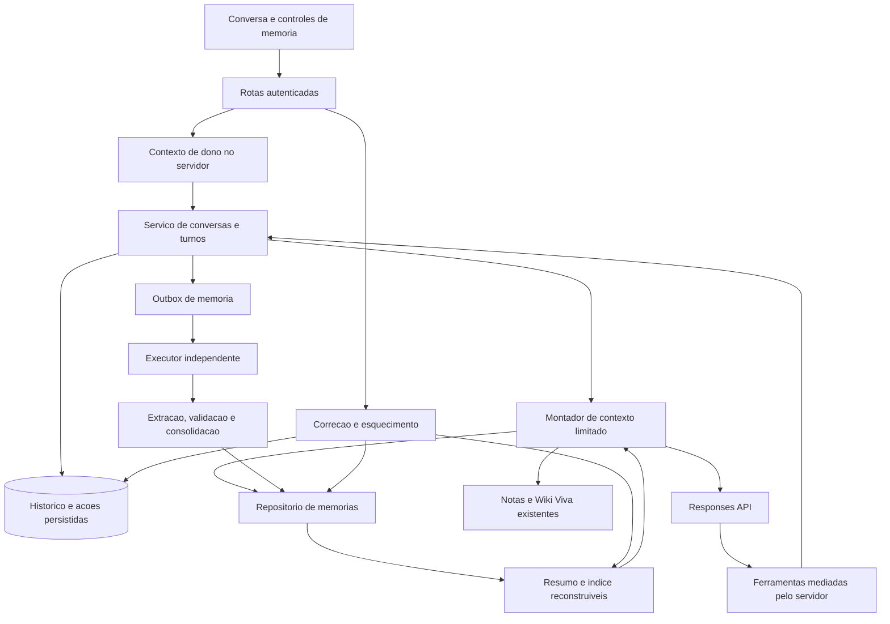

# Bimo — Plano de implementação do sistema de memória

Data: 27/10/2026. Revisão: 1. Estado: **proposta para revisão, sem implementação**.

Preparado com os critérios do ECC `intent-driven-development`, alternativas arquiteturais e práticas de migração do ECC `database-migrations`. As decisões abaixo são recomendações; o pedido autoriza este planejamento, não ativa retenção, processamento pago ou infraestrutura.

Base observada: branch `feat/wiki-viva-em-rede`, HEAD `e5d6394`. O ponteiro `.claude/worktrees/login-multiusuario` já estava modificado e não faz parte deste trabalho. A análise não verificou produção, banco remoto, conteúdo das notas ou configuração de ambiente.

## 1. Resultado que queremos

Permitir que uma pessoa retome conversas, objetivos, decisões e pendências no Bimo sem precisar repetir tudo, com lembranças rastreáveis, pertinentes e corrigíveis. O sistema deve conectar esse contexto ao conhecimento das notas e da Wiki Viva e permitir desligar a personalização, conversar temporariamente e esquecer informações.

Exemplo sintético de jornada:

1. A pessoa diz que está estudando redes, prefere exemplos práticos e deixou uma dúvida sobre sub-redes.
2. A conversa fica disponível para retomada. O objetivo, a preferência e a pendência são tratados separadamente, com origem e escopo.
3. Em outra conversa sobre redes, o Bimo recupera esse contexto e consulta notas e neurônios pertinentes.
4. Uma pergunta sobre culinária não recebe a pendência de redes como contexto obrigatório.
5. Se a pessoa corrigir a preferência, a antiga deixa de valer; se mandar esquecer, o dado sai também dos resumos e dos próximos contextos.

### 1.1 Quatro camadas do produto

| Camada | Conteúdo | Fonte de verdade | Evolução proposta |
| --- | --- | --- | --- |
| Conhecimento | Notas, sínteses, evidências, conexões e divergências | Notas e publicações da Wiki Viva | Reaproveitar; não duplicar todo o acervo |
| Conversas | Mensagens, respostas, fontes e ações concluídas | Histórico persistido pelo servidor | Criar armazenamento e retomada |
| Contexto pessoal | Preferências explícitas e objetivos duráveis | Registros de memória com origem | Criar captura seletiva e controles |
| Continuidade | Decisões, pendências, restrições e próximos passos | Memória com escopo e estado | Criar atualização e recuperação |

Memória de trabalho é o contexto selecionado para uma resposta; não constitui uma quinta base de fatos. Resumos e checkpoints são derivados descartáveis. A MemWiki em `.memory/wiki/` continua sendo a memória dos agentes de desenvolvimento, não um armazenamento de dados da pessoa.

## 2. Contexto confirmado e limites da análise

| Fato observado em 27/10 | Evidência a revalidar na implementação | Consequência |
| --- | --- | --- |
| Mensagens nascem em `useState([])` e o navegador envia o histórico | [Chat](../../../src/components/Chat.tsx), `mensagens` e `enviar` | Não há retomada durável nesse fluxo |
| A rota recebe até 40 mensagens, 20 mil caracteres por mensagem e 80 mil no total | [Rota do chat](../../../src/app/api/chat/route.ts), `validarMensagens` | Conversas longas precisam de novo contrato, não só banco |
| O agente admite 12 voltas, prazo de 150 s e guarda de 200 mil caracteres de contexto; a rota declara 180 s | [Agente](../../../src/lib/agente.ts), [rota](../../../src/app/api/chat/route.ts) | Planejar orçamento de contexto e margem de persistência |
| A chamada usa Responses diretamente, `store: false` e ferramentas próprias | [Transporte](../../../src/lib/openai.ts), [agente](../../../src/lib/agente.ts) | Memória não exige trocar o runtime |
| Os itens completos de resposta são preservados dentro da execução, mas o próximo pedido do navegador leva apenas papel/texto | [Agente](../../../src/lib/agente.ts), [Chat](../../../src/components/Chat.tsx) | Histórico legível e estado do protocolo precisam ser separados |
| Escritas podem ocorrer antes de uma resposta falhar; a interface preserva passos recebidos | [Chat](../../../src/components/Chat.tsx), [fluxo](../../../src/lib/fluxo-do-chat.ts) | Recuperação precisa consultar ações já concluídas |
| Há índice, resumos e vizinhos na Wiki Viva `rede-v5` | [Consulta](../../../src/lib/wiki/consulta.ts), [instruções](../../../src/lib/instrucao-do-agente.ts) | Recuperar conhecimento existente em vez de replicá-lo |
| Nota criada pelo chat a pedido pode ser raiz da Wiki Viva | [Instruções](../../../src/lib/instrucao-do-agente.ts), [decisões](../decisions.md) | Preservar essa decisão; texto solto do assistente não vira raiz automaticamente |
| Autenticação web atual é senha única; dono vem da configuração do servidor | [Autenticação](../../../src/lib/autenticacao.ts), [configuração](../../../src/lib/repositorio-de-notas/config.ts) | Isolar dados por dono, sem anunciar contas individuais já implementadas |
| Existem fila durável, geração, posse e consumo para a wiki | [Schema operacional](../../../src/lib/db/schema/wiki-automatica.ts), [agendamento](../../../src/lib/wiki/agendar.ts) | Reutilizar padrões, mantendo filas e orçamento de memória separados |
| Testes de banco real coexistem com offline | [Vitest](../../../vitest.config.mts), [regras](../../../CLAUDE.md) | Não usar `npm test` sem seleção explícita |

Não encontrado no caminho examinado: repositório de conversas, cadastro próprio de memórias pessoais e pipeline de consolidação de conversas. Essa constatação é sobre o checkout, não sobre funcionalidades do ChatGPT ou configuração remota.

### 2.1 Requisitos fornecidos e hipóteses

Fornecido: continuidade entre sessões; conhecimento já existente na Wiki Viva; registro seletivo de preferências, decisões e pendências; origem, correção, validade e esquecimento; análise das orientações oficiais da OpenAI; plano completo antes de implementar.

Não foram definidos: prazo de retenção, volume esperado, orçamento financeiro, padrão inicial da captura automática, tratamento de informações sensíveis, necessidade de memória no mobile e desenho visual. Estes pontos ficam como decisões de produto na seção 17. Valores numéricos neste documento são hipóteses de piloto, não limites aprovados nem SLA.

## 3. O que as referências oficiais estabelecem

Fontes consultadas novamente em 27/10/2026. A adaptação ao Bimo nas seções seguintes é proposta deste plano, não arquitetura obrigatória da OpenAI.

| Referência oficial | O que sustenta | Aplicação proposta |
| --- | --- | --- |
| [Conversation state](https://developers.openai.com/api/docs/guides/conversation-state) | Histórico manual, encadeamento por `previous_response_id` e Conversations com identificador durável | Escolher conscientemente onde persistir o histórico |
| [Compaction](https://developers.openai.com/api/docs/guides/compaction) | Compactação do estado; retorno opaco; preservação do conjunto retornado no endpoint explícito | Adaptador opcional para conversas extensas |
| [Sandbox Agents — memória](https://developers.openai.com/api/docs/guides/agents/sandboxes#persist-memory-across-runs) | SDK com `Memory`, extração e consolidação de arquivos; leitura progressiva de resumo, índice e detalhes | Reaproveitar o padrão de seleção e consolidação, sem impor sandbox |
| [Memory and Compaction — Cookbook](https://developers.openai.com/cookbook/examples/agents_sdk/building_reliable_agents_memory_compaction) | Preferências e lições reutilizáveis em memória; fatos da investigação em documentos revisáveis | Preservar o papel das notas e evidências da Wiki Viva |
| [Structured Outputs](https://developers.openai.com/api/docs/guides/structured-outputs) | Saídas com schema definido | Extrair propostas validadas de memória |
| [Function calling](https://developers.openai.com/api/docs/guides/function-calling) | Modelo solicita funções executadas pela aplicação | Expor busca e propostas de lembrança mediadas pelo servidor |
| [Supabase — RLS](https://supabase.com/docs/guides/database/postgres/row-level-security) | Políticas de acesso por linha e limites das conexões privilegiadas | Defesa adicional aos filtros explícitos de dono |

O SDK `Memory` é uma capacidade de Sandbox Agents, não um campo que se liga no transporte atual. Conversa persistida e compactação não substituem regras de autoria, validade e exclusão. `store: false` não significa retenção geral zero pelo provedor; consultar [Data controls](https://developers.openai.com/api/docs/guides/your-data) antes de definir garantias de privacidade.

## 4. Escolhas arquiteturais propostas

| Escolha | Recomendação e motivo | Alternativa considerada |
| --- | --- | --- |
| Persistência principal | Postgres do Bimo, com Drizzle e contratos de domínio próprios; permite revisão, origem, expurgo e isolamento no mesmo backend | Conversations hospedada: reduz gestão do protocolo, mas cria outro local de retenção, exclusão e dependência |
| Runtime | Manter Responses API e o laço atual; introduzir adaptadores de contexto e memória | Migrar para Agents SDK/Sandbox: útil para trabalho em arquivos, mas acrescenta ambiente e migração sem necessidade demonstrada |
| Memória durável | Registros pequenos, tipados por comportamento e ligados às origens; resumos como cache reconstruível | Um grande `MEMORY.md` por usuário: simples de exportar, difícil de concorrer, filtrar e expurgar granularmente |
| Recuperação | Busca textual, escopo, validade e prioridades explícitas; incluir o índice da Wiki Viva quando útil | Embeddings e reranking: evolução condicionada a falhas medidas |
| Compactação | Resumo legível estruturado primeiro; checkpoint opaco opcional por adaptador após validar o modelo usado | Guardar todo o histórico em todo pedido: cresce em custo e ultrapassa os limites atuais |
| Processamento | Outbox e fila de memória independentes; execução limitada e retomável | Só `after()` ou evento de fechar a aba: não garantem trabalho concluído |
| Conhecimento das notas | Referenciar nota/neuronio por ID e revisão | Copiar afirmações para memória: cria redundância e desatualização |

Estas escolhas estão em estado **proposto**. Não criar ADRs aceitos nem tratar as alternativas como decisões já tomadas pelo usuário.

## 5. Escopo e políticas de lembrança

Incluído: conversas persistentes; retomada; resumos de conversa; captura manual e automática seletiva; escopos; decisões e pendências; busca; origem; atualização; expiração; esquecimento; modos temporário e sem personalização; orçamento; observabilidade; testes e implantação gradual.

Fora desta entrega: memória nos pesos do modelo; reconstruir conversas já perdidas; nova base vetorial; pesquisa externa automática; migração obrigatória para Agents SDK; classificar manualmente todas as notas; publicar lembranças na Wiki Viva sem pedido; refazer login multiusuário ou o aplicativo mobile; implementar tensão entre neurônios, estacionada em outra tarefa.

### 5.1 Tipos e escopos

| Tipo interno | Exemplo sintético | Regra |
| --- | --- | --- |
| Preferência | “Prefiro exemplos práticos” | Global apenas quando a fala indica duração; uma instrução local fica na conversa |
| Objetivo | “Quero concluir o estudo de redes” | Associar ao assunto/projeto; permitir concluir, pausar ou revisar |
| Decisão | “Neste projeto usaremos PostgreSQL” | Guardar contexto, data e eventual decisão substituta |
| Pendência | “Retomar exercícios de sub-redes” | Estado aberta/concluída/cancelada e vínculo ao assunto |
| Restrição | “Neste projeto preciso trabalhar offline” | Não promover a regra universal |
| Aprendizado de interação | “A pessoa corrigiu a explicação anterior” | Guardar a correção sustentada, sem inferir diagnóstico ou atributo pessoal |

Escopos permitidos: dono, conversa e assunto/projeto identificado por ID opaco. Um assunto não precisa ser pasta nem categoria escolhida previamente; pode ser sugerido e confirmado durante o uso. Homônimos não são unidos automaticamente. Tipo é metadado interno; não obriga a pessoa a preencher formulários.

### 5.2 Promoção e autoria

- Captura explícita pela interface pode ativar a lembrança imediatamente, sem inferência paga. Classificação pode ocorrer depois.
- Pedidos no chat podem usar `propor_memoria`; o servidor verifica que a proposta aponta para o pedido e para texto do usuário. A referência literal não prova intenção: casos ambíguos continuam candidatos para revisão.
- Automação, quando habilitada, propõe lembranças a partir de declarações atribuíveis ao usuário. Somente fatos/preferências explícitos, não sensíveis e com escopo identificável podem passar pela promoção automática configurada.
- Hipóteses do modelo, texto citado/colado, personagens, dados de terceiros e contradições ficam fora da ativação automática. Inferência incerta permanece candidata e não é usada como fato.
- Respostas do assistente, resumos e repetições não são novas evidências independentes. Uma correção humana prevalece sobre inferência automática.
- A instrução atual de salvar uma resposta em nota quando solicitado continua valendo. Essa nota pode alimentar a Wiki Viva; cadastrar memória não chama `criar_nota` implicitamente.
- Credenciais e segredos detectados não entram em memórias ou resumos derivados. Isso não equivale a provar que todo dado sensível é detectável; retenção da mensagem original segue política própria.
- Conteúdo sensível não será promovido automaticamente na primeira versão. O tratamento manual depende da decisão D-04.

### 5.3 Estados e mudanças

Estados editoriais: `candidata`, `ativa`, `contestada`, `superada`, `expirada`, `arquivada`. Excluir remove o conteúdo; não manter o texto em um estado chamado “apagada”.

Pendências/objetivos têm também estado de domínio. A lembrança “o estudo foi concluído” pode continuar ativa enquanto a pendência fica concluída.

Atualizações usam `revisaoBase`. A substituição cria uma versão relacionada e marca a anterior como superada em transação. O modelo não escolhe sozinho que uma preferência global foi substituída por uma instrução de um turno. Quando duas declarações se contradizem sem resolver a diferença de escopo/tempo, marcar disputa e pedir esclarecimento no contexto pertinente.

Duplicata exata reforça a origem existente, sem criar outro registro. Similaridade apenas sugere possível duplicata; fusão ambígua é revisável. Repetição do assistente e número de acessos não aumentam confiança. Validade temporal é separada da data de acesso e da data da ocorrência.

## 6. Arquitetura funcional



Contratos propostos: `RepositorioDeConversas`, `RepositorioDeMemorias`, `MontadorDeContexto`, `ExtratorDeMemorias`, `ProcessadorDeMemoria`, `CompactadorDeContexto` e `ContextoDoDono`. Adaptadores em memória para testes e banco para execução persistente; não confundir “adaptador em memória” com a funcionalidade de memória pessoal.

Não copiar toda a implementação da fila da wiki. Extrair utilitários comprovadamente comuns apenas quando reduzirem duplicação sem mudar seus contratos. Uma falha no extrator deve deixar o chat e as notas operantes; uma falha em gravar uma conversa persistente deve ser comunicada antes de chamar o modelo ou executar ferramentas.

### 6.1 Identidade e acesso

`ContextoDoDono` é resolvido no servidor e injetado nos serviços e executores. No web atual, usa a configuração do dono depois da sessão válida. Não aceitar `userId` do cliente e não supor que o cookie atual identifica pessoas diferentes.

Todas as consultas, relações, caches, buscas, exportações, cursores e reservas incluem o dono. Memória pessoal entre várias pessoas exige a integração com o serviço de contas: sem identidade individual, todos que usam a senha única compartilham o mesmo dono. A primeira versão deve declarar essa limitação; a estrutura suporta isolamento futuro sem alegar que o login já o fornece.

RLS em tabelas expostas; nenhuma leitura direta pelo navegador é necessária. Preferir revogar acesso da Data API às novas tabelas operacionais, mantendo RLS como defesa. Se for necessária leitura por `authenticated`, usar política do dono, nunca apenas o papel. Escritas, exclusões e consumo permanecem no backend; filtros da aplicação continuam obrigatórios sob conexão privilegiada.

## 7. Modelo de dados proposto

DDL final e número da migração serão definidos na implementação, a partir do estado atual de `drizzle/meta`. Hoje há arquivos até 0011; não reservar uma numeração neste plano nem editar migrações já entregues.

Campos comuns: ID opaco, `user_id`, datas UTC; revisões positivas onde houver edição; tamanho limitado de texto/JSON; validação de estados. Datas da ocorrência e da captura não são intercambiáveis. IDs de fornecedor nunca são identidade de autorização.

| Tabela proposta | Conteúdo essencial | Integridade/índice |
| --- | --- | --- |
| `preferencias_memoria` | Um registro por dono: modo de captura, uso em respostas, política de retenção, `revisao`, `epoca_privacidade` | PK do dono; atualização otimista; incremento de época em correção/esquecimento relevante |
| `conversas` | Título, escopo opcional, estado aberta/arquivada, `revisao`, sequência corrente, versão do protocolo | Unicidade `(id,user_id)`; índice dono/data/id |
| `turnos_chat` | Conversa, chave idempotente do cliente, hash do pedido, estado, posse/prazo, última sequência de evento e consumo do chat quando disponível | Unique dono/conversa/chave; no máximo um turno em execução por conversa; FK composta |
| `mensagens_chat` | Conversa, turno, ordem, papel, conteúdo, estado final/interrompida; preferências de elegibilidade da origem | Unique conversa/ordem e ID/dono; índice de paginação estável; mensagens não reescritas silenciosamente |
| `eventos_chat` | Eventos reproduzíveis do turno e registro de ações: passo, fonte, intenção de escrita, resultado e finalização | Unique turno/seq; unique chave de operação; payload público limitado e separado dos argumentos privados necessários à recuperação |
| `contextos_conversa` | Resumo estruturado legível ou checkpoint opaco, watermark de mensagens, versões de modelo/prompt, época, estado e expiração | Unique conversa/versão; só usar quando origens/época ainda conferem; invalidável |
| `memorias` | Texto curto, tipo, natureza explícita/inferida, estado editorial/domínio, escopo, chave normalizada, versão, origem manual/automática, validade e substituição | Índices dono/estado/escopo e busca textual; restrição de identidade ativa para chaves determinísticas; sem unicidade global por texto |
| `evidencias_memoria` | Memória e revisão, mensagem/nota de origem, revisão/hash, trecho e localização, atribuição, elegibilidade | Referência a exatamente um tipo de origem; FKs compostas onde aplicável; índice reverso por origem; não considerar resumo como raiz |
| `resumos_memoria` | Resumo compacto por dono/escopo, IDs e revisões incluídos, fingerprint, época, versão de política | Cache reconstruível; vínculo reverso para invalidação; sem texto esquecido em versões antigas |
| `trabalhos_memoria` | Tipo, origem/faixa, cursor, watermark de fim, geração, posse, estado, tentativas, adiamento e última categoria de erro | Chave idempotente por origem/faixa/política; índice pendentes por disponibilidade/dono; progresso monotônico |
| `consumos_memoria` | Reserva, uso confirmado/incerto, tarefa/modelo/política, dia UTC | Índice dono/dia; reservas atômicas; apagar conteúdo não devolve consumo |
| `eventos_memoria` | Criada, corrigida, superada, esquecida, extração sem mudança e falha; ator e IDs | Só metadados necessários; sem texto anterior, citações ou prompts em eventos de exclusão |
| `exclusoes_memoria` | Origens/faixas excluídas da extração e operações em expurgo, época e progresso | Sem texto esquecido; verificação na seleção e publicação; protege contra tarefas atrasadas |

### 7.1 Detalhes que o schema não deve deixar implícitos

- Tipos de memória são metadados internos evolutivos, não uma taxonomia imposta às notas.
- FKs devem impedir relações entre donos diferentes, inclusive conversa/turno/evento/memória/evidência. Referências opcionais a fontes têm `CHECK` de exclusividade; não basta guardar ID sem tipo em JSON.
- `memorias` separa validade de confiança e autoria. Não apresentar confiança do modelo como probabilidade calibrada.
- Evitar tabelas genéricas de grafo para esses registros: memória não se torna nó visual nem neurônio por existir.
- Históricos de edição de memória são revisáveis, mas também estão sujeitos ao esquecimento; “imutável” não autoriza conservar texto que deveria ser expurgado.
- Registros de operação precisam persistir somente argumentos necessários. Não copiar respostas completas de ferramentas, notas inteiras ou raciocínio privado para o diário público.
- Contadores e sequências não usam `max()+1` sem serialização; ordem e paginação têm desempate por ID e precisão preservada.
- Os índices de busca textual seguem a configuração já usada no projeto; eventual ranking semântico é um adaptador futuro.

## 8. Conversa persistente e recuperação de turnos

### 8.1 Contrato HTTP novo

Manter `/api/chat` para compatibilidade enquanto a interface migra; o fluxo durável usa rotas próprias. Os formatos abaixo são propostas versionadas, não endpoints existentes.

| Método e rota proposta | Entrada/saída principal |
| --- | --- |
| `POST /api/conversas` | Cria conversa; pode definir escopo; não chama modelo |
| `GET /api/conversas` | Lista paginada por cursor opaco do dono |
| `GET /api/conversas/[id]` | Metadados e mensagens paginadas; informa turno ativo/interrompido |
| `PATCH /api/conversas/[id]` | Título/arquivar/escopo com `revisaoBase` |
| `POST /api/conversas/[id]/turnos` | `{mensagemId,conteudo,chaveIdempotencia,revisaoBase}`; carrega histórico canônico no servidor; JSON ou NDJSON |
| `GET /api/conversas/[id]/turnos/[turnoId]` | Estado, ações e eventos posteriores ao cursor; leitura não executa modelo |
| `POST /api/conversas/[id]/turnos/[turnoId]/cancelar` | Cancelamento solicitado e estado final observável |
| `DELETE /api/conversas/[id]` | Exclusão/expurgo pela política da seção 12; invalida derivados |
| `GET/POST /api/memorias`; `GET/PATCH/DELETE /api/memorias/[id]` | Busca/lista, cadastro explícito, revisão e esquecimento |
| `GET/PATCH /api/memorias/preferencias` | Modo, personalização e retenção, com revisão |
| `POST /api/memorias/processar` | Executor próprio autenticado, sem aceitar dono arbitrário do navegador |

Reservar caminhos estáticos sem colisão com segmentos dinâmicos; ler o guia Next instalado antes de implementar as rotas. Sessão em cada rota; mesma origem nas mutações do navegador; JSON validado, limites de tamanho, cursores limitados ao dono e `Cache-Control: no-store`. O segredo do executor de memória não abre rotas de chat, notas ou wiki.

Erros: 401 sessão expirada; 404 para ID ausente ou de outro dono; 409 revisão/turno concorrente ou chave reaproveitada com outro conteúdo; 413 entrada excessiva; 429 admissão limitada; 503 persistência/configuração indisponível. Falha do modelo após admissão termina o turno como falho/interrompido e conserva as ações confirmadas.

### 8.2 Admissão e protocolo de eventos

1. Autenticar, resolver dono e verificar modo/revisão/época.
2. Em transação curta, admitir o turno, persistir a mensagem e a chave idempotente; rejeitar segundo turno concorrente na conversa.
3. Montar contexto a partir do histórico do servidor. O cliente não fornece mensagens antigas do assistente como verdade.
4. Chamar o agente fora da transação. A execução continua limitada pelo prazo do runtime; não prometer processamento em background sem executor específico.
5. Persistir cada evento necessário antes de transmiti-lo. Evento NDJSON contém `turnoId`, `seq`, `tipo` e payload permitido. Conservar os campos de passo consumidos por `fluxo-do-chat` durante a transição.
6. Persistir resposta final, fontes, estado e trabalho de extração no mesmo fechamento transacional. A resposta só é anunciada como salva depois disso.
7. Cliente reconecta por leitura de eventos; sequência elimina duplicatas. Uma leitura nunca reinicia um turno.

Se o stream cair, desconectar cancela a execução ativa na primeira versão, como no comportamento atual; uma resposta já persistida continua recuperável. Um processo que morre deixa posse expirar e o reconciliador marca o turno interrompido. A pessoa pode continuar por um novo turno após ver as ações concluídas. Não retomar automaticamente o laço antigo.

Repetir a mesma chave devolve o mesmo turno; se ele já acabou, reproduz eventos/resultado; se ainda executa, informa o estado. Não abre outra chamada paga. Usar a mesma chave com corpo diferente retorna 409. Perder a resposta de admissão não permite duplicar a mensagem.

### 8.3 Escritas e janela de incerteza

A deduplicação atual existe apenas dentro de `responder`. Para recuperação entre requisições, cada escrita precisa de identidade persistente vinculada ao turno e à chamada/etapa; duas edições intencionais iguais em etapas diferentes não devem ser colapsadas por assinatura de texto.

Na escrita em banco, levar a chave de operação até a porta de escrita e gravar a nota e seu recibo de operação **na mesma transação**. O evento público pode ser derivado desse recibo; confirmar no fluxo só depois do commit. Preserve revisão-base e leitura prévia para substituir. Uma nova conversa ou replay não reutiliza autorização/revisão antiga para editar uma nota.

Sem atomicidade comprovada em algum adaptador, marcar ação de resultado incerto e exigir conferência antes de nova tentativa; não anunciar exatamente uma vez. Falha entre efeito e registro não pode ser resolvida repetindo cegamente a ferramenta. Falha apenas na transmissão pode ser resolvida reproduzindo o recibo.

Modo temporário não guarda conversa nem gera memória; pode continuar usando notas a pedido. Se permitir escritas, guardar somente recibo operacional mínimo sujeito à política de retenção, explicar que as notas gravadas persistem e não alegar ausência absoluta de registros. Não salvar o texto da conversa por conveniência de recuperação.

## 9. Construção do contexto e recuperação progressiva

Ordem de composição: instruções confiáveis e ferramentas; mensagem atual; restrições locais; turnos recentes completos; resumo de trabalho validado; memórias ativas pertinentes; consulta a notas/Wiki Viva quando necessária. Memória recuperada é dado identificado, nunca instrução de sistema ou autorização de ferramentas.

O montador deve devolver o envelope e um diagnóstico sem conteúdo privado: versões, contagens/tokens estimados, itens omitidos e motivo. O orçamento considera tudo enviado e saída reservada; não só `input`. O limite de 40 mensagens continua apenas no caminho legado. A nova conversa usa janela limitada sobre um histórico maior; os limites de tamanho de cada mensagem continuam validados.

### 9.1 Seleção

1. Filtrar por dono, permissão de uso, estado, validade, escopo, exclusão e origem acessível.
2. Carregar um resumo pequeno de preferências globais explícitas; uma pergunta irrelevante pode não precisar de outros registros.
3. Buscar candidatos por termos normalizados, aliases e assunto; priorizar correspondência de escopo antes da recência.
4. Ordenar por aplicabilidade, explicitude e revisão; decisões atuais antes de superadas. Recência desempata, não transforma uma afirmação em verdade.
5. Abrir detalhes/evidências somente dos registros selecionados. Expor `buscar_memorias` e `ler_memoria` para aprofundamento limitado.
6. Registrar IDs/revisões efetivamente usados na resposta para explicação e invalidação. Exibir “Usei esta lembrança” com acesso à origem quando houver impacto relevante.

Não varrer todas as memórias nem todos os neurônios a cada pergunta. Manter caches por dono/escopo/revisão/época; nunca cache global só pela pergunta. Limitar relações e profundidade. Contexto local mais recente pode afastar uma preferência global naquele turno sem substituí-la no cadastro.

### 9.2 Limites iniciais para medir, não requisitos de produto

| Parcela | Hipótese de piloto |
| --- | --- |
| Resumo da conversa | Até 1.500 tokens |
| Memórias pessoais/continuidade | Até 1.500 tokens e 12 registros |
| Turnos recentes | Até 8.000 tokens, preservando pares e resultados necessários |
| Retornos de ferramentas e conhecimento | Até 12.000 tokens acumulados |
| Saída e margem | Reserva compatível com o modelo e o limite de saída configurado |

Calcular o limite efetivo a partir da configuração verificada do modelo; reduzir parcelas se necessário. Não supor que somar esta tabela garante compatibilidade com qualquer modelo. Separar medição de tokens de caracteres/bytes; estimativa local deve ser identificada e conservadora. Manter limite de bytes e Unicode íntegro na montagem HTTP.

Ao faltar espaço, cortar candidatos menos relevantes e compactar/resumir história anterior. Nunca cortar silenciosamente a pergunta atual, uma restrição ativa ou metade de uma interação de ferramenta. Informar cobertura limitada quando afetar a resposta; não declarar acesso a toda a base.

### 9.3 Resumo e compactação

Resumo legível com campos: objetivo atual, decisões, pendências, restrições, referências de origem, watermark e cobertura. Registrar faixas realmente resumidas, não somente a última mensagem visível. Janelas enormes são divididas; cursor só avança sobre a parte coberta. Evitar ciclos de “resumo do resumo” sem possibilidade de conferir as mensagens.

O checkpoint opaco da OpenAI será opcional: validar suporte no modelo configurado e preservar itens completos do protocolo, incluindo `phase`, reasoning criptografado e relações de ferramentas. Não extrair nem expor raciocínio privado. O retorno de `/responses/compact` inteiro é o próximo contexto; não conservar apenas o item `compaction` e descartar o restante.

Resumo/checkpoint guarda versão e época. Após correção, exclusão ou mudança de escopo, invalidar e reconstruir apenas de origens permitidas. Se houver estado opaco contaminado, descartá-lo integralmente. Se o compactador falhar ou o modelo não suportar, usar resumo legível mais turnos recentes dentro do orçamento; não falhar o chat por uma otimização opcional.

Mudar a permissão de personalização também invalida o contexto derivado que embutia memórias recuperadas. O histórico visível continua existindo; desligar personalização não promete apagar informações já ditas nas mensagens. A função de esquecer tem alcance distinto, definido na seção 12.

## 10. Extração, validação e consolidação

### 10.1 Gatilhos e execução

Cada fechamento de turno persistente registra trabalho na outbox. Trabalho é elegível apenas conforme o modo de captura e a época vigente. Agregar faixas próximas; o desligamento da captura impede consumir trabalhos antigos. Um resultado válido sem memória é sucesso com avanço, não erro nem motivo para pagar de novo.

Não depender de fechar aba, logout ou encerrar formalmente a conversa. Usar estabilidade/inatividade e faixas processáveis; mensagem explícita de lembrança pode usar caminho prioritário. `after()` acelera; executor autenticado independente garante retomada. Reconciliador identifica trabalhos ausentes sem iniciar um backfill irrestrito de conversas anteriores à opção da pessoa.

### 10.2 Proposta do modelo

Uma chamada estruturada retorna operações `criar`, `reforcar`, `propor_substituicao`, `registrar_conflito` ou `sem_mudanca`; cada operação tem alvo opcional, tipo, texto, escopo proposto, fontes/trechos, temporalidade e motivo de elegibilidade. IDs, revisão vigente, dono, autorização, expiração e chave final são atribuídos/confirmados pelo servidor.

Validação por operação, preservando propostas independentes válidas: schema estrito; fonte real e do dono; mensagem atribuível ao usuário; citação/posição dentro da origem correta; escopo permitido; política de dados sensíveis; origem não excluída; revisão e época atuais; limite de quantidade e tamanho; não uso de resposta gerada como declaração humana.

Uma citação literal valida localização, não sustentação semântica. Conservar candidato/indicação de revisão quando a interpretação não for demonstrável por regra; avaliar esse comportamento no corpus de piloto. O modelo não recebe ferramenta de SQL nem de expurgo irrestrito.

### 10.3 Consolidação e concorrência

- Fora de transações: leitura de snapshots autorizados e chamada ao modelo.
- Dentro de transação curta: revalidar posse, geração, configuração, exclusões, origens e revisões; publicar operações válidas, evidências, eventos e avanço.
- Ganhar posse não autoriza publicar depois que ela expirou. Conferir quantidade de linhas alteradas; zero invalida a publicação.
- Cada operação tem chave determinística para idempotência. Detectar duplicata exata antes de pedir inferência; aproximação textual é pista, não autorização de mescla.
- Editar manualmente protege aquela revisão da reescrita automática até devolução explícita; novas evidências não substituem texto humano silenciosamente.
- Limites por rodada e documento exigem cursor por faixa/candidata efetivamente avaliada. Não encerrar tudo por ter visto somente as primeiras N memórias.
- Concluir uma pendência, mudar prazo e trocar preferência são operações distintas. Registrar motivo e preservar rastreabilidade até eventual expurgo.
- Não reencaminhar para a Wiki Viva cada memória criada; não extrair de resumos/neurônios como se fossem novas raízes. Isso evita aprendizagem circular e cascata de custo.

## 11. Orçamento, agendamento e falhas

Fila de memória tem estados `pendente`, `processando`, `concluido`, `adiado`, `revisar` e `configuracao`, com motivo, tentativas, geração, cursor, lease e disponibilidade. “Sem mudança” conclui/avança. Esgotar orçamento adia sem gastar tentativa. Repetir uma mesma falha sem progresso termina em revisão; nova evidência ou retomada explícita pode reabrir.

Reservar custo atomicamente por dono/dia UTC antes da inferência. Registrar modelo, operação, versões e uso real quando retornado. Timeout ou conexão perdida após envio conserva reserva como incerta. Uma falha anterior ao envio libera reserva; não presumir ausência de cobrança só pelo código HTTP. Publicação idempotente não garante chamada externa cobrada exatamente uma vez.

Configurações propostas: `MEMORIA_PERSISTENTE_ATIVA`, `MEMORIA_AUTOMATICA_ATIVA`, `MEMORIA_TETO_DIARIO_TOKENS`, `MEMORIA_MAX_TOKENS_POR_CHAMADA`, `MEMORIA_COMPACTACAO_ATIVA`, prazo de retenção validado e segredo de executor. Nomes finais devem seguir a convenção existente; valores não serão lidos de `.env` neste planejamento.

Separar ledger e teto da memória dos da Wiki Viva e do chat; mostrar o total por subsistema. Compartilhar um limite superior opcional do dono impede que a soma escape à intenção de gasto. Token não equivale a real: preço depende do modelo e deve ser consultado no piloto. Não escolher modelo novo apenas por existir; avaliar inicialmente o configurado no Bimo.

Escalonar no máximo um trabalho de memória por dono ao mesmo tempo; múltiplos donos com justiça. Não segurar transação durante inferência. Priorizar resposta interativa e comandos explícitos; a manutenção não monopoliza conexão/cota da wiki. Autenticação inválida do provedor interrompe o processamento daquele dono; erros transitórios usam espera limitada e observável.

Métricas sem conteúdo: filas/idade, tempo por etapa, memória criada/recusada/corrigida, duplicatas, sem mudança, cobertura, tokens reservados/reais/incertos, falhas por categoria e latência adicionada. Não registrar prompts, textos, citações, argumentos com notas ou corpos de erro do provedor.

## 12. Controles de privacidade, correção e esquecimento

### 12.1 Operações diferentes

| Ação da pessoa | Efeito proposto |
| --- | --- |
| Desligar captura automática | Não extrair novas memórias; lembrar explicitamente ainda é possível |
| Desligar personalização | Não consultar memórias duráveis nas respostas; não apaga histórico ou registros |
| Nova conversa temporária | Sem histórico durável, sem leitura/escrita de memória durável; contexto só durante a sessão |
| Corrigir lembrança | Nova revisão com origem e prioridade humana; invalidar derivados |
| Esquecer lembrança | Excluir conteúdo e derivados; bloquear reextração das mesmas origens; explicar separadamente a retenção das mensagens originais |
| Apagar conversa | Tornar indisponível, interromper trabalho e expurgar mensagens/derivados; não apagar notas criadas a pedido |
| Apagar tudo da memória | Expurgar memórias, evidências, resumos e checkpoints; suspender reextração do histórico anterior até nova escolha |
| Apagar histórico e memória | União dos expurgos; mostrar claramente que as notas têm ciclo de vida próprio |

Desligar personalização não impede o usuário de pedir explicitamente para ler uma nota. Esquecer uma memória não autoriza apagar uma nota nem outra base. Se o dado também está numa nota, mostrar o vínculo e permitir que a pessoa decida sobre ela. Não prometer que o modelo não poderá reencontrar um fato que continua em uma origem consultada explicitamente.

### 12.2 Garantia contra reaparecimento por processamento antigo

1. Em transação: incrementar `epoca_privacidade`, registrar exclusões de origem/faixa, bloquear uso do registro e invalidar resumos/checkpoints que o incluam.
2. Impedir novos contextos e publicações com época antiga. Captura/resumo/recuperação verificam tanto política quanto origem excluída.
3. Cancelar turnos ativos atingidos e não persistir/emitir nova resposta baseada no contexto invalidado. Revalidar época antes de ações e da conclusão.
4. Expurgar em lotes texto, evidências, versões e caches persistidos; registrar só metadados de progresso. Acusar “indisponível para uso” imediatamente e “expurgo concluído” somente depois da limpeza verificável.
5. Reconstruir derivados a partir das origens permitidas, sem tentar editar um checkpoint opaco.

Esquecer uma lembrança mantendo a conversa exige marcar os trechos de origem como excluídos também da montagem automática do contexto; o original pode continuar visível no histórico conforme a escolha informada. Se não for possível excluir apenas o trecho com segurança, excluir a mensagem inteira do contexto automático. A garantia se refere à recuperação futura pelo Bimo, não a apagar tokens já enviados, texto já visto ou registros fora de seu controle.

Uma nova declaração explícita posterior pode registrar novamente o assunto como nova origem. Tombstones não guardam o conteúdo esquecido nem bloqueiam toda a vida futura da pessoa por semelhança textual. Restauração de backup precisa reaplicar exclusões antes de liberar leitura/captura; política e prazo de backups devem ser definidos em D-03.

O expurgo percorre também títulos gerados de conversas, payloads de eventos/recibos, respostas do assistente que reproduzam o trecho excluído, resultados persistidos de ferramentas e eventuais índices de busca. Identificar dependências por IDs/revisões/faixas; se uma resposta derivada não permitir remover só o trecho com segurança, invalidar/remover o conteúdo derivado inteiro conforme o alcance informado. Um cache de índice ou um diário não pode virar cópia residual da informação esquecida.

### 12.3 Retenção

Definir separadamente retenção de mensagens, candidatas recusadas, memórias ativas/superadas, checkpoints e metadados operacionais. A aplicação não deve aceitar retenção “indefinida por acidente” como decisão aprovada. Até D-03, ambientes de teste usam dados sintéticos e expurgo curto configurável; produção não habilita armazenamento novo sem a política visível.

Expiração remove elegibilidade antes do expurgo. Arquivar não significa esquecer. Exportação autenticada inclui registros legíveis e origem, sem raciocínio privado, segredo ou dados de outro dono. Exportar e exclusão são paginados e retomáveis. Prazos contratuais ou obrigações legais não foram fornecidos e não são inferidos deste código.

## 13. Integração com notas e Wiki Viva

- Notas e neurônios continuam pesquisáveis pelas ferramentas atuais. Memória guarda preferências/continuidade e referências de IDs/revisões, não cópia geral do conhecimento.
- O texto de resposta pode explicar se uma informação veio de lembrança de conversa, nota, síntese ou conhecimento geral. Referência de conversa abre a mensagem; referência de nota abre por ID, preservando renomeação.
- Uma origem editada/inacessível invalida evidências dependentes. Revisão antiga pode ser mostrada apenas como histórico permitido, nunca como evidência atual silenciosa.
- “Guarde isso como nota” usa o fluxo existente; “lembre que prefiro...” usa memória. Ambiguidade pode gerar uma pergunta específica, sem criar ambos silenciosamente.
- Nova memória não gera nota, nó, sinapse ou trabalho da wiki. Nota gravada a pedido segue sendo raiz legítima, inclusive quando escrita pelo agente.
- Se a pessoa promover uma conclusão da conversa a nota, a nota se torna o artefato persistente revisável e pode entrar na Wiki Viva. O vínculo não aumenta independência das evidências nem converte opinião em fato.
- O sistema de memória não altera a política `rede-v5`, a proteção editorial dos neurônios nem a tarefa estacionada de tensões. Compartilhamento de utilitários exige testes de regressão da wiki.

## 14. Experiência funcional, sem redesenho antecipado

Entregar: criar/retomar/arquivar/apagar conversa; visualizar progresso de turno e ações concluídas; lista pesquisável de lembranças; origem e escopo; editar/corrigir/esquecer; pendências; modos de captura e personalização; conversa temporária; estado de processamento e consumo.

Conservar `Chat` e `GrafoDeFundo` montados ao trocar de área; trocar a conversa altera dados, não a identidade do componente. Não usar `router.refresh()` para sincronizar a memória. Paginar históricos; cancelar leituras antigas para não misturar duas conversas. Limpar estado por dono na transição de conta, se essa integração vier a existir.

Comandos no chat podem propor lembrar, corrigir, concluir ou esquecer; operações de alto alcance, como apagar todas as conversas, exigem ação de interface que mostre o alcance concreto. Não pedir confirmação para cada lembrança trivial quando a captura automática estiver habilitada; a escolha de modo governa essa autorização.

Estados verificáveis: carregando, vazio, modo desativado, candidato aguardando revisão, captura em andamento, orçamento esgotado, persistência indisponível, sessão expirada, revisão conflitante, exclusão em progresso e concluída. Controles acessíveis por teclado, foco previsível, rótulos de estado, erros próximos da ação e nenhum conteúdo privado em notificações genéricas.

Design visual segue o sistema existente e será especificado junto das telas; o plano define comportamento. O mobile recebe contratos documentados, mas sua implementação não faz parte das fases web.

## 15. Organização proposta de código

| Área | Novos arquivos/pastas ou ajustes planejados |
| --- | --- |
| Conversas | `src/lib/conversas/{tipos,validacao,servico,memoria,banco,turnos,eventos,recuperacao}.ts` e testes próximos |
| Memória | `src/lib/memoria/{tipos,politica,servico,memoria,banco,evidencias,extracao,consolidacao,recuperacao,resumos,esquecimento}.ts` e testes |
| Trabalho e custo | `src/lib/memoria/{fila,executor,consumo,configuracao,disponibilidade}.ts`, adaptadores e testes |
| Contexto | `src/lib/contexto-do-agente/{montagem,orcamento,resumo,compactacao}.ts` e testes |
| Banco | Novos módulos em `src/lib/db/schema/`, exportação no barrel, migrações novas e snapshots gerados |
| HTTP | Rotas de conversas/memórias, validação comum e processamento de memória |
| Agente | Adaptar `agente.ts`, `openai.ts`, instruções e ferramentas; manter transporte e erros sanitizados |
| Escritas | Propagar identidade de operação em `porta-de-escrita-do-agente.ts` e adaptadores do repositório de notas |
| Interface | `Chat.tsx`, `fluxo-do-chat.ts`, tipos e componentes próprios de conversas/memória; integração sem remount |
| Operação | `scripts/executar-memoria.mjs`, testes de argumentos/segredos, documentação do executor |

Nomes e divisão são orientativos: implementar fatias por domínio, evitando concentrar toda a feature em um serviço gigante. Resolver o dono numa fronteira comum, sem `userId` global compartilhado entre requisições. Antes de novos usos de APIs Next, ler a documentação instalada pertinente em `node_modules/next/dist/docs/`.

## 16. Fases de implementação e dependências

Cada fase pede teste RED do comportamento relevante, implementação GREEN e revisão do diff; não espelhar detalhes internos em testes. Nenhuma fase é considerada concluída por ter só arquivos ou mocks.

| Fase | Entrega concreta | Dependência e arquivos principais | Saída verificável |
| --- | --- | --- | --- |
| F0 — Contratos e decisões | Políticas D-01 a D-07, contratos de dono, estados, API e fixtures | Este plano, contratos e testes puros | Critérios aceitos; produção ainda desligada |
| F1 — Persistência básica | Conversas/mensagens/turnos/eventos, migração aditiva e repositórios | F0; schema e `conversas/` | Contratos iguais em memória e Postgres local; isolamento/constraints |
| F2 — Turno durável | Admissão idempotente, recibo transacional de escrita, replay e reconciliação | F1; rota, agente e porta de escrita | Falha depois de gravar não duplica nota; resposta perdida é recuperável |
| F3 — Retomada e contexto | Histórico paginado, conversa selecionável e resumo por faixas; protocolo completo | F2; `Chat`, montagem e resumos | Recarregar retoma; ultrapassar 40 mensagens no histórico não quebra a nova rota |
| F4 — Memória explícita e controle | Cadastro, busca, revisão, estados, origem, retenção e esquecimento completos | F0–F3; `memoria/`, controles | Lembrar/corrigir/esquecer funciona sem extração automática; expurgo testado |
| F5 — Contexto personalizado | Recuperação progressiva, cache invalidável, indicação de origem e escopos | F4; contexto/ferramentas | Lembrança útil reaparece; irrelevante/superada/excluída não entra |
| F6 — Captura automática | Extração estruturada, validação, outbox, consolidação, orçamento e executor | F4–F5; geração/filas/consumo | Cobertura progride, sem mudança encerra e jobs antigos não recriam exclusões |
| F7 — Compactação opcional | Adaptador OpenAI, compatibilidade do modelo e fallback | F3/F5; transporte e contexto | Checkpoint íntegro, invalidação e recuperação após erro |
| F8 — Piloto e operação | Corpus aprovado, qualidade/custo/latência, migração e rollout por flags | F1–F6; F7 pode permanecer desligada | Evidências do piloto, limites escolhidos e operação documentada |

Primeira entrega utilizável: F1–F4, com histórico persistente e memória explícita. Primeira entrega completa de personalização automática: F1–F6 e F8. Compactação opaca é independente e não bloqueia a feature se os resumos atendem ao corpus inicial. Não atribuir prazos de calendário sem estimar volume e capacidade da equipe.

## 17. Decisões abertas para revisão do produto

O plano pode ser revisado e os contratos offline podem ser detalhados sem responder agora. Resolver as escolhas abaixo antes da fase dependente; não tratar silêncio como aprovação.

| ID | Questão | Recomendação inicial | Bloqueia |
| --- | --- | --- | --- |
| D-01 | Onde guardar histórico? | Banco do Bimo; manter `store: false`; não adotar Conversations hospedada nesta fase | F1 |
| D-02 | Captura inicial automática ou explícita? | Modo explícito no primeiro release; automática seletiva como opção visível e reversível | Ativação F6 |
| D-03 | Retenção por classe e backups? | Política separada e visível; definir prazos antes de produção, sem prazo inventado | Produção F1/F4 |
| D-04 | Informações sensíveis? | Sem promoção automática; opção manual somente com regra clara de exibição, retenção e acesso | Ativação dessa categoria |
| D-05 | Compartilhamento sob senha única? | Piloto do dono atual; não disponibilizar como memória privada de múltiplas pessoas até identidade individual | Release multiusuário |
| D-06 | Orçamento e limites? | Teto próprio de memória, total por subsistema e piloto com limite pequeno aprovado | Chamada paga/produção F6/F7 |
| D-07 | Qual o alcance inicial de “esquecer”? | Remover derivados e excluir origens do contexto automático; oferecer apagar mensagem/conversa separadamente | F4 |
| D-08 | Mobile e desenho de telas? | Web primeiro; contratos reaproveitáveis, design seguindo sistema existente | Interface correspondente |

## 18. Critérios de aceite e plano de evidências

Todas as linhas têm prioridade **obrigatória**, salvo indicação. Cenário e ação estão na primeira coluna; resultado inclui o efeito proibido relevante. Evidências começam como **pendentes**; estes testes não foram escritos ou executados neste planejamento.

| ID | Cenário e ação | Resultado observável | Verificação planejada |
| --- | --- | --- | --- |
| AC-001 | Recarregar após resposta final persistida | Mensagens, fontes e ações reaparecem em ordem; sem nova chamada ao modelo | Componente + rota/repositório offline; navegador no piloto |
| AC-002 | Reenviar a chave após perder a resposta HTTP | Mesmo turno/mensagem; nenhuma nova escrita ou chamada paga | Repositório com barreiras de concorrência e contagem de chamadas falsas |
| AC-003 | Reusar chave com outro conteúdo | 409; histórico original preservado | Teste de contrato HTTP |
| AC-004 | Duas abas enviam na mesma revisão | Um turno admitido; outra recebe 409 e pode sincronizar | Duas conexões Postgres local + componente |
| AC-005 | Acessar ID/cursor/lembrança de outro dono | 404/recusa sem conteúdo; nenhuma relação cruzada no banco | Rotas, contratos, constraints e RLS em Postgres isolado |
| AC-006 | Criar lembrança explícita e abrir outra conversa pertinente | Registro recuperável com origem e escopo; sem criar nota/neuronio | Serviço, montagem e jornada de interface |
| AC-007 | Dizer “seja breve nesta resposta” e iniciar outro assunto | Instrução local não vira preferência global ativa | Corpus sintético e validação de escopo; amostra real autorizada |
| AC-008 | Extrator vê uma resposta inventada, citação ou personagem | Não ativa o conteúdo como declaração humana | Fakes adversariais + avaliação semântica do corpus |
| AC-009 | Corrigir memória enquanto um job antigo termina | Revisão humana permanece; job antigo conflita/descarta | Corrida controlada nos dois adaptadores |
| AC-010 | Registrar afirmações incompatíveis sem decisão posterior | Não funde silenciosamente; conflito/escopo é visível | Consolidação pura + avaliação editorial |
| AC-011 | Repetir extração/publicação da mesma faixa | Sem duplicatas; origens independentes preservadas | Idempotência e publicação em transação |
| AC-012 | Modelo retorna `sem_mudanca` válido | Cursor/cobertura avançam, sem repetição paga da mesma janela | Fila + contagem do gerador falso |
| AC-013 | Faixa contém mais conteúdo/candidatos que o limite | Só recorte avaliado avança; restante é retomado | Teste de duas ou mais rodadas, limites e Unicode |
| AC-014 | Pergunta não relacionada ou memória vencida | Não injeta conteúdo irrelevante, expirado, contestado ou superado como fato | Recuperação determinística e corpus com rótulos |
| AC-015 | Conversa durável passa de 40 mensagens | Próxima resposta usa janela válida; histórico permanece paginável completo | Montador, rota v2 e componentes |
| AC-016 | Ferramentas/saída estruturada consomem o orçamento | Contexto final cabe no limite e mantém pares; nunca trunca a mensagem atual | Contagem/estimador marcado, Unicode e snapshot do envelope |
| AC-017 | Compactação retorna vários itens | Reenvia conjunto completo com metadados de protocolo; falha usa fallback | Transporte mockado; piloto de compatibilidade autorizado |
| AC-018 | Esquecer enquanto há resumo/job/turno ativo | Dado deixa de entrar em respostas e publicações futuras; estado opaco invalidado; expurgo verificável | Corridas, reconstrução e inspeção do payload enviado |
| AC-019 | Reprocessar conversa antiga após esquecimento | Origem excluída não recria memória; nova fala explícita pode criar nova origem | Reconciliador, política e corpus de regressão |
| AC-020 | Apagar conversa que originou memórias e uma nota | Remove histórico/derivados conforme alcance; nota continua até decisão própria | Expurgo, vínculos e jornada de interface |
| AC-021 | Desligar captura, personalização ou usar modo temporário | Cada controle tem o efeito da seção 12; nenhuma persistência oculta de conversa temporária | Serviço, rota, filas e componente |
| AC-022 | Banco falha antes de admitir turno persistente | Sem modelo/ferramenta; erro informa que não foi salvo | Falha injetada em admissão |
| AC-023 | Nota grava e stream/processo falha depois | Recibo e nota coerentes; reconexão exibe ação; não repete escrita | Teste transacional e falhas em pontos distintos |
| AC-024 | Lease expira ou época muda durante publicação | Nenhuma escrita tardia; zero linhas causa conflito | Transação/relógio controlado |
| AC-025 | Reservas concorrentes e timeout após envio | Teto não é excedido pela admissão; consumo incerto não é devolvido | Postgres local com duas conexões e relógio UTC |
| AC-026 | Extrator indisponível ou orçamento esgotado | Chat/notas seguem; fila mostra adiamento sem loop de tentativas | Serviço/fila/rotas offline |
| AC-027 | Trocar conversas/áreas rapidamente e usar teclado | Sem mistura de mensagens, remount de chat/grafo ou perda de foco | Testing Library + revisão manual acessível |
| AC-028 | Modelo recebe nota com instrução maliciosa | Memória não amplia permissões, segredo não aparece em logs/saídas | Corpus adversarial + inspeção de logs sanitizados; limite semântico declarado |
| AC-029 | Desabilitar feature ou voltar versão de app | Notas/wiki funcionam; dados novos preservados, sem migração destrutiva | Ensaio de rollout/rollback em staging |
| AC-030 | Restaurar backup após pedido de exclusão | Exclusões reaplicadas antes da leitura; conteúdo não volta a ser elegível | Ensaio operacional isolado documentado |

### 18.1 Avaliação de qualidade

Corpus sintético versionado com pelo menos 40 jornadas: preferência durável/local; decisões que mudam; assuntos homônimos; pendência concluída; negação/hipótese; informação de terceiro; segredo; correção; interrupção; fontes inacessíveis; exclusão; conversa longa; Unicode e instrução maliciosa. Separar conjunto usado para ajustar prompts do conjunto de avaliação final.

Medir precisão da promoção, lembranças úteis recuperadas, intrusões de contexto irrelevante, vinculação de origem, conflitos detectados, correções humanas e reaparecimento após exclusão. Comparar sem memória, memória explícita e captura seletiva. Avaliação determinística não prova interpretação; incluir revisão humana por amostra.

Gates propostos de piloto: zero vazamento entre donos, zero ressurreição por jobs antigos e zero duplicação de escrita nos cenários determinísticos; 100% das memórias ativas com origem resolvível ou autoria manual; pelo menos 95% de promoções automáticas julgadas adequadas e 90% das lembranças esperadas recuperadas no conjunto rotulado. Os dois últimos são metas propostas para revisão, não qualidade garantida nem amostra suficiente para generalização estatística.

Medir p50/p95 da latência adicionada à montagem, custo por turno e por memória útil, tamanho do contexto e idade da fila. Estabelecer metas de desempenho depois da linha de base no ambiente do piloto; não inventar SLA. Fluxo explícito e sem mudança devem evitar inferência adicional desnecessária.

### 18.2 Comandos e ambientes futuros

Usar `npx.cmd` no PowerShell. Exemplos a adaptar aos arquivos realmente criados:

```powershell
npx.cmd vitest run src/lib/conversas src/lib/memoria src/lib/contexto-do-agente
npx.cmd vitest run src/components/Chat.test.tsx src/components/Chat.fluxo.test.tsx src/lib/agente-openai.test.ts
npx.cmd tsc --noEmit
npx.cmd eslint src scripts
git diff --check
```

Ampliar para regressões de rotas, escrita de notas, wiki e componentes quando forem tocados. Suíte offline ampla deve excluir explicitamente `src/lib/repositorio-de-notas/banco.test.ts` e `src/lib/tests/busca-textual.integration.test.ts`, além de qualquer integração nova identificada na implementação. Não usar a pasta genérica `src/lib/tests` como sinônimo de offline.

Fakes de OpenAI, relógio e falhas de rede nos testes comuns; PGlite para partes compatíveis de SQL; Postgres local isolado para concorrência, RLS, grants e migrações. Emular papéis autenticados/anon quando aplicável; o teste privilegiado sozinho não prova RLS. Sem usar `USER_ID_PADRAO` real em fixtures. Modelo real e Supabase hospedado são ensaios separados autorizados, com dados sintéticos ou corpus aprovado e teto de gasto.

## 19. Migração, implantação e reversão

1. **Expandir:** novas tabelas/índices/constraints e schema; sem reescrever o acervo. Gerar e revisar migrações Drizzle; testar instalação limpa e atualização sobre baseline local equivalente. Não operar banco remoto neste planejamento.
2. **Disponibilidade:** validar tabelas, colunas, índices/constraints essenciais e versão da feature antes de capturar dados ou reservar inferência. Ausência gera estado de configuração, não falha genérica nem consumo pago.
3. **Implantar desligado:** deploy compatível com caminho legado; controles/rotas não anunciam persistência disponível antes da migração. Verificar leitura e autenticação em staging.
4. **Ativar histórico e explícita:** dono/corpus aprovado, retenção definida, expurgo e recuperação já disponíveis. O frontend escolhe o novo contrato por capability do servidor, não por adivinhar tabelas.
5. **Ativar recuperação:** comparar respostas com e sem memória; observar relevância e latência. Não ativar extração antiga em massa.
6. **Ativar captura seletiva:** escolha visível da pessoa e teto; acompanhar fila e amostra. Processar somente faixas elegíveis desde a opção, salvo importação expressa.
7. **Compactação:** habilitar separadamente depois do ensaio de compatibilidade e exclusão.
8. **Consolidar:** documentar operação e resultados. Remover contrato legado apenas após mapear consumidores e comunicar mudança; sem remoção nesta primeira migração.

Reversão operacional: desligar captura/compactação, parar executor e voltar ao contexto não personalizado; preservar dados para inspeção autorizada. Se persistência for desligada, interface informa modo temporário/indisponibilidade e não finge que salvou. Alterações de schema em produção seguem migrações corretivas futuras; não apagar tabelas nem reverter migrações com conteúdo do usuário para desfazer um deploy.

Backfill: não há como recuperar conversas antigas que só existiam em RAM. Importação de históricos exportados é tarefa futura, com deduplicação, origem e consentimento próprios. Notas e neurônios existentes já são consultáveis, não precisam virar memórias duplicadas.

## 20. Riscos e mitigação

| Risco | Mitigação e evidência exigida |
| --- | --- |
| Memória atribuir ao usuário uma frase do modelo/terceiro | Elegibilidade de autoria, candidatos e corpus adversarial; AC-008 |
| Preferência local dominar todo o produto | Escopos e precedência por turno; AC-007/014 |
| Memória corrigida/esquecida reaparecer | Época, exclusão de origem, invalidação e revalidação na publicação; AC-009/018/019 |
| Escrita duplicada após conexão perdida | Chave persistente e recibo na transação da nota; AC-002/023 |
| Orçamento duplicado ou perda de consumo incerto | Reservas transacionais e ledger separado; AC-025 |
| Usuários da mesma senha tratados como pessoas isoladas | Declarar dono único; integrar contas antes de release pessoal multiusuário; AC-005 |
| Falhas de memória derrubarem chat/notas | Separar dependências e caminhos; AC-022/026 |
| Resumos apagarem nuances/contradições | Origem e cobertura por faixa, revisão e estados contestados; AC-010/013 |
| Dados pessoais em logs/backup | Logs sem corpo, retenção e protocolo de restauração; AC-028/030 |
| Mudanças na API/modelo invalidarem checkpoint | Adaptador versionado, compatibilidade medida e fallback; AC-017 |

## 21. Checklist de conclusão da implementação futura

- [ ] Políticas e decisões dependentes revisadas, com recomendação ou escolha registrada.
- [ ] Conversas retomáveis e turnos com idempotência e recuperação demonstradas.
- [ ] Memórias explícitas, origem, escopo, revisão e conflitos verificáveis.
- [ ] Esquecimento e retenção abrangem versões, resumos, checkpoints, filas e restauração.
- [ ] Captura seletiva respeita modo, autoria, exclusões e orçamento.
- [ ] Contexto limitado e progressivo; integração com notas/Wiki Viva preservada.
- [ ] Isolamento e segurança testados nos papéis e adaptadores relevantes.
- [ ] Interface acessível e estados de falha conferidos sem remount do chat/grafo.
- [ ] Migração/rollback ensaiados no ambiente isolado.
- [ ] Corpus de qualidade e piloto com custo/latência registrados; não confundir mocks com produção.
- [ ] Operação, flags, recuperação, expurgo e resultados atualizados na MemWiki.

## 22. Revisão deste planejamento

Entrega documental: plano completo e referências oficiais; nenhuma implementação, migração, teste de software ou chamada de modelo foi executada. Validação de links e diff será registrada no log da sessão.

Autoavaliação ECC do plano, antes da entrega:

| Eixo | Nota | Evidência e melhoria pendente |
| --- | --- | --- |
| Precisão | 4/5 | Base local e referências separadas de propostas; compatibilidade de compactação com o modelo configurado ainda exige ensaio |
| Completude | 4/5 | Cobre dados, rotas, filas, falhas, privacidade, custos, testes e rollout; prazos de retenção dependem de decisão de produto |
| Clareza | 4/5 | Fluxo, tabelas e fases permitem navegação; detalhar telas em especificação própria quando escolhidas |
| Execução | 4/5 | Dependências, arquivos e AC-001–030 orientam fatias; converter cada fase em backlog só após revisar escolhas |
| Concisão | 4/5 | Documento extenso para permitir implementação; seção 16 é a porta de entrada para execução por fases |

Média: 4,0/5. Nenhum eixo abaixo de 4. Melhorias de maior impacto: resolver D-03/D-07 antes da retenção real; ensaiar compatibilidade do compactador e o custo da captura antes de ativar. Autochecagem: a entrega atende ao pedido de planejamento; as notas avaliam a proposta, não certificam código ou aprovação do usuário.

### Histórico de revisão

| Revisão | Data | Alteração |
| --- | --- | --- |
| 1 | 27/10/2026 | Proposta inicial sobre o checkout `e5d6394`; 30 critérios de aceite e fases F0–F8 |
