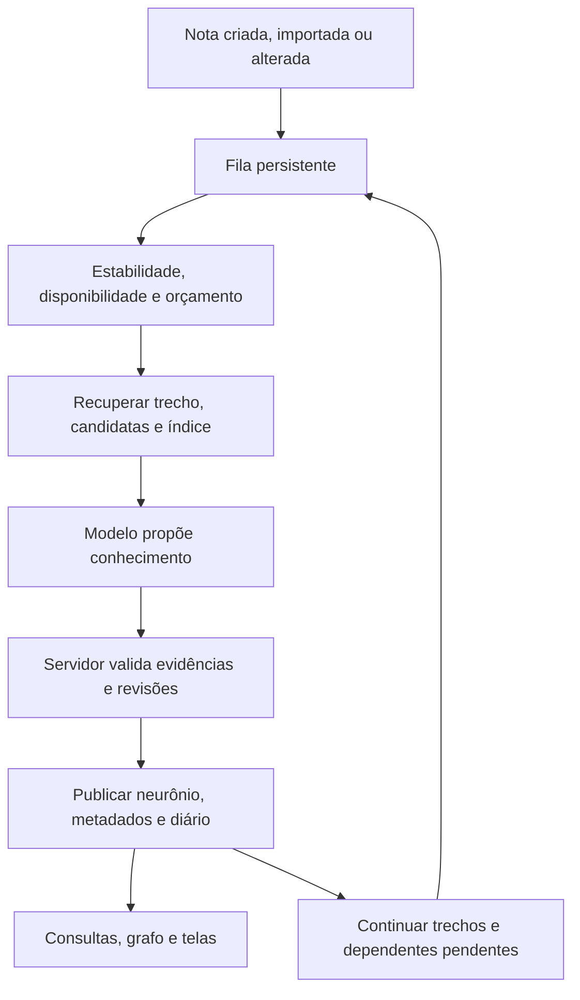

# LLM Wiki — funcionamento, referência no Obsidian e base para comparação

Data da consulta: **23/10/2026**. Referência local: branch `feat/estrutura-llmwiki`, commit `8a0a49a`.

Este documento explica o padrão LLM Wiki, registra uma implementação pesquisada no Obsidian e descreve a Wiki Viva encontrada no código do Bimo. A matriz e os cenários finais podem ser usados na comparação funcional do sistema.

**Escopo da verificação:** leitura do código e da documentação local do Bimo; pesquisa em fontes primárias dos projetos externos. O plugin do Obsidian não foi instalado nem testado. A presença de código no Bimo não confirma migrações aplicadas, automação ativada ou qualidade de inferência em produção. A pasta local `.llm-wiki-memory/`, usada por ferramentas de memória de agentes, é outro componente e não foi tomada como a Wiki Viva do aplicativo.

## 1. O que é uma LLM Wiki

É uma base de conhecimento que um modelo de linguagem cria e mantém a partir de fontes. O resultado fica salvo em páginas interligadas e pode ser enriquecido nas próximas leituras e consultas.

O padrão de Karpathy distingue três camadas: **fontes originais**, **wiki derivada** e **regras de manutenção**. As operações centrais são incorporar fontes, responder perguntas com referências e revisar a saúde da base. Um índice ajuda a localizar páginas; um registro cronológico acompanha as alterações. Boas respostas também podem ser incorporadas à wiki. A proposta é modular: não estabelece um plugin, banco ou algoritmo obrigatório. [Fonte original: LLM Wiki](https://gist.github.com/karpathy/442a6bf555914893e9891c11519de94f).

### Exemplo ilustrativo

Você registra três notas: uma sobre um projeto, outra sobre dificuldade de concentração e uma terceira sobre seu horário de trabalho. Uma wiki pode reunir as relações em uma página sobre condições de trabalho, apontando quais notas sustentam cada conclusão. Quando chega uma experiência diferente, a página deve incorporar o contexto e preservar eventuais divergências.

### Relação com RAG

RAG significa fornecer informações recuperadas ao modelo para apoiar uma resposta. Uma wiki pode participar dessa recuperação. Para comparar sistemas, separe duas perguntas: **qual conhecimento é persistido antes da consulta?** e **como o contexto da resposta é recuperado?** Ter sínteses persistentes não determina usar ou dispensar embeddings.

## 2. Como a Wiki Viva do Bimo funciona

As descrições desta seção foram conferidas nos módulos listados na seção 7. Representam comportamento implementado, sujeito à ativação e às condições operacionais.

### 2.1 Fontes, neurônios e evidências

As notas pessoais são as raízes do conhecimento. A automação publica notas derivadas, chamadas **neurônios**, na mesma base de notas. Novos neurônios nascem em `Neurônios`; a identificação vem dos metadados, portanto uma nota pessoal nessa pasta não se torna automaticamente uma síntese.

Cada neurônio possui afirmações identificáveis, classificadas como informação explícita ou inferência. As evidências associam a afirmação a uma nota de origem, revisão, trecho citado e posição. Os snapshots compactos conservam hashes e trechos utilizados.

Uma síntese pode aproveitar conhecimento apresentado por outra, mas suas evidências precisam chegar às raízes pessoais. Repetir a mesma origem em duas sínteses não cria duas fontes independentes.

### 2.2 Ciclo de processamento

1. As escritas elegíveis registram trabalho junto da gravação da nota. Autosaves próximos são consolidados, com janela de estabilidade de 90 segundos. Mudanças apenas de organização acompanham a revisão sem exigir nova inferência sobre o mesmo conteúdo.
2. A reconciliação inclui notas anteriores à ativação. O executor processa trabalhos persistidos; uma rodada não equivale a ler o acervo inteiro.
3. O compilador seleciona um trecho da origem, notas candidatas e um índice compacto dos conceitos existentes.
4. O modelo, pela Responses API com saída estruturada, pode criar, enriquecer ou decidir que não há mudança útil. A chamada não recebe ferramentas de execução.
5. O servidor verifica as propostas. Nota, histórico, evidências, conceito, progresso e eventos de publicação são gravados de forma atômica.
6. O cursor e as ondas de dependentes permitem continuar o trabalho em rodadas seguintes.

### 2.3 Duas buscas diferentes dentro do Bimo

**Busca para construir conhecimento:** `recuperacao.ts` extrai termos do título e do trecho. Pondera repetição e raridade no acervo, trata acentos e alguns plurais, preserva siglas e considera títulos, aliases e dependências. Dependentes desatualizadas pela origem têm prioridade. O modelo recebe até seis candidatas e um índice de até 120 entradas, limitado também por tamanho. Esse índice pode estar incompleto.

**Busca para responder no chat:** a ferramenta procura conteúdo das notas e acrescenta conhecimento da wiki por resultados e aliases. `consultarConhecimentoWiki` devolve até três sínteses, cobertura e evidências ainda verificáveis. O texto da síntese só entra nesse complemento quando ela está atualizada; citações que perderam validade são excluídas. Uma falha da wiki permite continuar a busca normal das notas.

Na implementação consultada, a recuperação da Wiki Viva é textual e por dependências. Os links aparecem na navegação e no grafo, mas esses módulos de recuperação não executam Personalized PageRank nem busca vetorial. Exibir um grafo não demonstra que a consulta percorre suas conexões.

### 2.4 Enriquecimento e atualização

Uma atualização pode acrescentar afirmações, substituir ou retirar afirmações identificadas, relacionar neurônios, registrar perguntas em aberto e preservar divergências com os contextos dos dois lados. As afirmações não mencionadas nas operações são preservadas conforme as regras de validade das evidências.

Uma ligação entre neurônios indica relação; ela não é uma evidência independente nem exige uma ligação recíproca. As arestas visuais são derivadas dos `[[links]]` no texto.

Alterar uma origem deixa suas dependentes aguardando revalidação. Editar manualmente o conteúdo de um neurônio protege o texto contra a manutenção automática. Pausar a consolidação e devolver o gerenciamento ao Bimo são operações distintas.

### 2.5 O que aparece para a pessoa

| Área | Comportamento presente no código |
| --- | --- |
| Cérebro | Grafo, lista de neurônios, filtros, cobertura, consolidação e energia disponível |
| Diário | Nascimento, crescimento, divergências, impedimentos e outros eventos; paginação dos últimos sete dias na tela atual |
| Neurônio aberto | Afirmações, inferências sinalizadas, origens, citações, divergências, relacionados e perguntas em aberto |
| Evidências | Acesso à nota de origem e ao trecho citado |
| Gerenciamento | Editar, pausar, retomar e devolver ao Bimo, com controle de revisão |

Os estados incluem vivo, reconsolidando, seu, em tensão, sem raízes e em pausa. “Notas lidas” mede trabalhos concluídos na revisão atual; não certifica extração exaustiva nem correção das conclusões.

### 2.6 Operação e limites

A automação depende de configuração, estrutura de banco compatível e executor. Há executor contínuo, aceleração após atividade e configuração de Cron diário. A fila conserva progresso e distingue impedimentos de configuração, revisão e falhas transitórias.

O orçamento diário é em tokens por dono, separado do chat. A reserva antecede a geração e considera consumo incerto. Limites de contexto, candidatas, raízes e afirmações restringem cada rodada. Não há garantia de descobrir todas as relações possíveis.

Citação localizada confirma a existência do trecho; não comprova que a conclusão decorre dele. Perguntas e respostas do chat não viram evidência nova automaticamente.

## 3. Implementação pesquisada no Obsidian

### 3.1 Obsidian como ambiente

O Obsidian oferece busca textual com operadores como `path:`, `file:` e `content:`. Por exemplo, `path:wiki "concentração"` restringe a pesquisa à pasta indicada. Essa busca localiza conteúdo; a geração de uma resposta por IA depende de uma integração adicional. [Busca nativa](https://help.obsidian.md/plugins/search).

O grafo nativo mostra notas e links, com filtros e visualização local de profundidade ajustável. [Grafo nativo](https://help.obsidian.md/plugins/graph).

### 3.2 Plugin de referência

Foi escolhido o **Karpathy LLM Wiki**, projeto `GD4AI/obsidian-llm-wiki`, disponível como plugin comunitário. É uma implementação de terceiros inspirada no padrão original.

O projeto documenta ingestão de notas, pastas ou seleções, criação de páginas de entidades, conceitos e fontes, links entre páginas, consultas com referências, diagnóstico e correção de problemas. A wiki é armazenada em Markdown na pasta `wiki/`; as notas originais são preservadas. Há suporte a provedores externos e modelos locais. A opção `reviewed: true` protege páginas contra sobrescrita. Esses recursos foram verificados na documentação, sem teste de execução. [Repositório e funcionalidades](https://github.com/GD4AI/obsidian-llm-wiki).

PDFs, imagens e documentos de escritório têm caminhos de conversão específicos, incluindo provedor compatível, MinerU e alternativas locais. O local de processamento depende do caminho escolhido; usar Obsidian não torna toda inferência automaticamente local. [Guia de ingestão e OCR](https://github.com/GD4AI/obsidian-llm-wiki/blob/main/docs/PDF-OCR-GUIDE.md).

### 3.3 Como a busca da wiki funciona

A documentação descreve quatro fases: ler o índice, selecionar páginas iniciais, carregar páginas e montar o contexto da resposta. A seleção começa pela correspondência lexical em títulos e aliases. Quando o sinal é insuficiente, pode usar palavras-chave propostas pelo modelo e uma varredura local. A expansão por **Personalized PageRank** recupera páginas conectadas às selecionadas. A resposta é então gerada com referências às páginas.

Isso permite alcançar relações por vários links, além da correspondência direta de palavras. Não exige embeddings no mecanismo documentado. É uma descrição do projeto, sem medição independente nesta pesquisa. [Arquitetura da consulta](https://llmwiki.greenerai.top/blog/posts/query-engine-pipeline/).

### 3.4 Conhecimento gerado por perguntas e manutenção

O fluxo **Save to Wiki** permite conservar uma resposta como página ligada ao conhecimento existente. O guia também descreve verificação de sobreposição antes de criar outra página. [Salvar consultas](https://llmwiki.greenerai.top/blog/posts/query-to-wiki-feedback/).

O projeto documenta detecção de conflitos entre fontes e opções de correção ou preservação sinalizada dos dois lados. Isso é uma capacidade declarada; sua eficácia exige avaliação com casos reais. [Tratamento de divergências](https://llmwiki.greenerai.top/blog/posts/contradiction-detection/).

## 4. Matriz inicial para comparação

**Bimo:** presença verificada no código local, sem confirmar ativação. **Obsidian:** comportamento documentado pelo plugin e pelas fontes ligadas na seção 3, sem execução nesta pesquisa. “Não identificado” significa que a equivalência não foi estabelecida, não que o recurso seja impossível.

| Eixo | Bimo — Wiki Viva | Plugin no Obsidian |
| --- | --- | --- |
| Persistência | Notas e metadados no banco | Arquivos Markdown |
| Conhecimento derivado | Neurônios com afirmações e evidências | Páginas de entidades, conceitos e fontes |
| Entrada principal | Ciclo das notas e reconciliação | Comandos de ingestão |
| Recuperação | Texto, aliases e dependências | Léxico e expansão PPR no grafo |
| Evidência | Trecho, origem, revisão e validação atual | Referências às páginas; equivalência por revisão não verificada |
| Resposta vira página | Não há promoção automática no fluxo consultado | Save to Wiki documentado |
| Edição humana | Proteção por edição; devolução explícita | Proteção por reviewed |
| Divergências | Pares estruturados e contexto | Detecção e tratamento documentados |
| Manutenção | Diagnóstico local e diário | Lint e correções documentados |
| Execução local de modelos | Não identificada no gerador consultado | Suporte documentado |
| Fila e orçamento | Persistentes, com reserva de tokens | Equivalência não verificada |
| Grafo | Visualização própria a partir dos links | Grafo nativo do Obsidian |

O padrão original é uma referência de arquitetura. Para comparar funcionalidades concretas, use uma implementação identificada e registre a versão examinada, pois plugins e documentação mudam.

## 5. Cenários para a comparação funcional posterior

Use o mesmo pequeno conjunto de fontes nos dois sistemas e registre o resultado observado, suas evidências e o custo. Os exemplos abaixo são critérios propostos, não testes já executados.

| Cenário | O que verificar |
| --- | --- |
| Duas notas complementares sobre um tema | Se nasce uma síntese útil com evidências das duas origens |
| Nova nota sobre um conceito existente | Se o sistema enriquece a página adequada sem duplicá-la |
| Pergunta com sinônimo ausente do título | Se a recuperação encontra conhecimento relevante |
| Relação que exige atravessar dois links | Se o contexto inclui a conexão intermediária |
| Nota longa com informação no final | Se o processamento alcança a informação sem declarar cobertura antes |
| Fonte corrigida depois da síntese | Se a informação anterior deixa de ser apresentada como atual |
| Duas fontes com conclusões diferentes | Se ambos os contextos são preservados e identificados |
| Edição manual da síntese | Se uma atualização automática respeita a edição |
| Fonte removida ou inacessível | Se a citação deixa de ser apresentada como evidência atual |
| Pergunta sem suporte no acervo | Se a resposta distingue ausência de evidência e conhecimento geral |
| Resposta que merece ser guardada | Se há fluxo para persistir e recuperar a síntese posteriormente |
| Falha do modelo ou limite de consumo | Se as notas continuam disponíveis e o trabalho pode ser retomado |

Para cada caso, preencha: **resultado esperado, resultado observado, origem consultável, lacuna, custo/latência e condição de execução**. Classifique como atendido, parcial, ausente ou não verificado. Uma funcionalidade em código e uma funcionalidade demonstrada em uso devem ter registros distintos.

## 6. Pontos que ainda exigem verificação

- Ativação da Wiki Viva no ambiente escolhido, migrações efetivamente aplicadas e funcionamento do executor.
- Qualidade das sínteses, recuperação, divergências e citações com um conjunto de notas aprovado.
- Versão instalada do plugin, execução dos fluxos documentados e comportamento de proteção/reprocessamento.
- Equivalência entre referências do plugin e rastreabilidade por trecho/revisão do Bimo.
- Qualidade, custo e tempo com o mesmo corpus e perguntas; esta pesquisa não estabelece superioridade de uma abordagem.

## 7. Referências locais para conferir o Bimo

| Assunto | Arquivos consultados |
| --- | --- |
| Operação, ativação e limites | [Wiki Viva — Operação](./Bimo%20-%20Wiki%20Viva%20-%20Operacao.md) e [Pendências](./Bimo%20-%20Wiki%20Viva%20-%20Pendencias.md) |
| Histórico das entregas | [Plano de Notas no Banco](./Bimo%20-%20Plano%20de%20Notas%20no%20Banco.md) |
| Fontes, afirmações e estrutura | [tipos.ts](../src/lib/wiki/tipos.ts), [estrutura.ts](../src/lib/wiki/estrutura.ts) e [automacao-tipos.ts](../src/lib/wiki/automacao-tipos.ts) |
| Geração e validação | [gerador.ts](../src/lib/wiki/gerador.ts) e [automacao.ts](../src/lib/wiki/automacao.ts) |
| Recuperação durante compilação | [recuperacao.ts](../src/lib/wiki/recuperacao.ts) |
| Consulta e evidências no chat | [consulta.ts](../src/lib/wiki/consulta.ts) e [ferramentas.ts](../src/lib/ferramentas.ts) |
| Busca textual no repositório | [banco.ts](../src/lib/repositorio-de-notas/banco.ts) |
| Configuração e disponibilidade | [configuracao.ts](../src/lib/wiki/configuracao.ts) e [disponibilidade.ts](../src/lib/wiki/disponibilidade.ts) |
| Telas e estados | [PainelDaWiki.tsx](../src/components/wiki/PainelDaWiki.tsx), [NeuronioAberto.tsx](../src/components/wiki/NeuronioAberto.tsx), [cliente.ts](../src/lib/wiki/cliente.ts) e [observabilidade-tipos.ts](../src/lib/wiki/observabilidade-tipos.ts) |

Os links externos nas seções 1 e 3 são as fontes da pesquisa sobre o padrão e o Obsidian. Nenhuma descrição de recurso externo deve ser tratada como validação prática do plugin.
