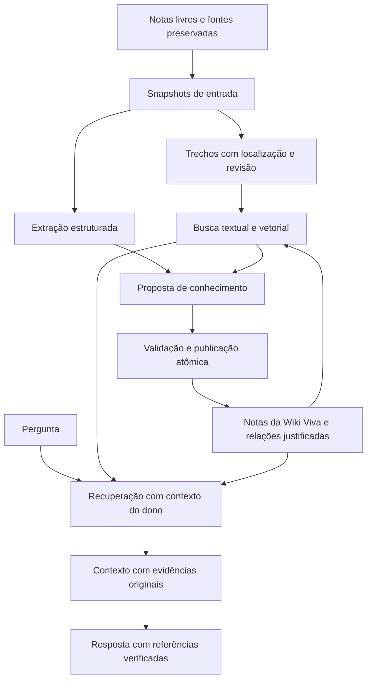

# Bimo — Plano de RAG e Wiki Viva

Data: 21/10/2026. Estado: **proposta detalhada para revisão pelo Claude; implementação ainda não autorizada por este documento**.

## 1. Intenção do produto

O usuário anota livremente. O Bimo adapta sua organização ao conteúdo que aparece na base: assuntos, formatos, vocabulários e relações emergem das anotações. Não haverá uma taxonomia obrigatória nem exigência de transformar cada anotação em um formulário.

A Wiki Viva cria novas notas de conhecimento, amplia notas derivadas existentes e constrói sínteses entre diferentes registros. Ela deve permitir que uma descoberta útil permaneça disponível para perguntas futuras. Crescer significa melhorar explicações, conexões, evidências e cobertura; o número de páginas não é uma medida de sucesso.

Exemplo de aceitação: notas sobre cache, edição simultânea e sincronização offline sustentam uma nova nota sobre consistência entre cópias. Uma anotação posterior sobre sistemas distribuídos pode enriquecer essa síntese. O usuário consegue abrir as anotações que sustentam cada afirmação e distinguir informação registrada de inferência produzida pela IA.

Este plano define decisões recomendadas para o Bimo. A documentação da OpenAI fundamenta as capacidades das APIs; ela não prescreve o esquema de banco, a política editorial nem garante a qualidade da wiki. As propostas de produto e os parâmetros experimentais abaixo são decisões locais sujeitas à revisão.

## 2. Escopo desta entrega e relação com o roadmap

- Esta entrega adiciona o plano e registra sua existência no plano de notas. Também acompanha o commit das mudanças já pendentes da migração do chat para GPT-6 Luna.
- Não implementa RAG, wiki, migrações, tarefas agendadas ou alterações de interface.
- Não executa inferência real, ingestão da base, leitura de `.env`, migrações ou testes contra Supabase.
- A implementação futura atravessa Retrieval, Agent 2.0 e consolidação do conhecimento, descritos em [Visão e Direção](./Bimo%20-%20Vis%C3%A3o%20e%20Dire%C3%A7%C3%A3o%20do%20Projeto.md). Não considerar essas fases concluídas pela criação deste plano.
- [Retrieval — Fase 4](./Bimo%20-%20Retrieval%20%28Fase%204%29.md) permanece a referência histórica da busca textual. Recomenda-se antecipar citações e montagem de contexto em relação à ordem original do checklist.
- [Sources & Ingestion](./Bimo%20-%20Sources%20%26%20Ingestion%20%28Fase%203%29.md) continua responsável por extração e preservação das fontes. Transcrição, OCR e novos formatos ficam fora do primeiro ciclo.

## 3. Estado observado no checkout

Base da inspeção: branch `feat/grafo-vivo`, HEAD `4185d0d`, com mudanças pendentes da migração do chat. Isto é uma inspeção local; não comprova o estado do banco remoto nem a disponibilidade dos modelos na conta.

| Área | Evidência no repositório | Consequência para o plano |
| --- | --- | --- |
| Chat | `src/lib/agente.ts`, `openai.ts`, `ferramentas-openai.ts` | Responses API por HTTP nativo; modelo padrão `gpt-6-luna`; cinco ferramentas existentes |
| Limites do chat | Até cinco chamadas, 45 segundos, 4.096 tokens de saída por chamada, contexto serializado limitado | Compilação da wiki precisa de execução própria, separada do pedido interativo |
| Armazenamento | `RepositorioDeNotas`, implementações banco e memória | Preservar a porta existente; acrescentar uma porta de conhecimento para recuperação e compilação |
| Busca | `busca-textual.ts`, `repositorio-de-notas/banco.ts` | Full-text search em português; `ts_rank`, não BM25; ainda sem embeddings |
| Revisões | `notas.revisao`, concorrência otimista, `versoes_nota.sessao_aberta` | Histórico do editor não deve ser presumido como snapshot imutável de cada revisão |
| Conhecimento | Tabelas `nos`, `entidades`, `relacoes`, `fontes`, `proveniencia` | Reaproveitar identidades e fontes; acrescentar evidências por afirmação e dependências de revisão |
| Relações | `indice-de-ligacoes.ts` e enum de relações | `[[links]]` continuam derivados do texto; não espelhá-los na tabela `relacoes` |
| Proveniência | `proveniencia.locator` reservado para trechos | Vínculo fonte→nota já existe; citação precisa de granularidade e validação adicionais |
| Extração | PDF usa texto mesclado das páginas conforme documentação da Fase 3 | Citar página de PDF exige preservar o mapeamento na extração; não inventar paginação |
| Identidade | Convenções atuais ainda usam dono configurado e conexão privilegiada; há plano de login multiusuário | Projetar todo novo serviço com contexto explícito do dono, sem depender de RLS para proteger conexão proprietária |

Antes de implementar, reconciliar [Architecture Audit](./Bimo%20-%20Architecture%20Audit.md), [Plano de Login Multiusuario](./Bimo%20-%20Plano%20de%20Login%20Multiusuario.md), `CLAUDE.md` e o código atual. `criadoPor = agente` identifica autoria; não identifica automaticamente uma página gerenciada da wiki.

Há uma divergência histórica relevante: o Architecture Audit descreve wikilinks como relações persistidas, enquanto `CLAUDE.md` e a implementação atual determinam derivação do texto sem espelhamento. Este plano segue a regra atual; a reconciliação documental deve preservar essa distinção.

## 4. O que aproveitar da OpenAI

Documentação oficial consultada em 21/10/2026. Revalidar schemas, suporte do modelo e preços antes de implementar ou executar experimentos pagos.

| Recurso oficial | Aplicação proposta | Referência |
| --- | --- | --- |
| Responses API e function calling | O modelo pede buscas e leituras; o servidor valida e executa as operações | [Function calling](https://developers.openai.com/api/docs/guides/function-calling) |
| Structured Outputs | Extrator e compilador produzem propostas com formato validável; verificação semântica continua necessária | [Structured Outputs](https://developers.openai.com/api/docs/guides/structured-outputs) |
| Embeddings | Vetorizar consultas e trechos, mantendo os vetores no Postgres | [Embeddings](https://developers.openai.com/api/docs/guides/embeddings) |
| GPT-6 Luna | Manter o modelo atual como candidato inicial para consulta e compilação; suporte documentado a ferramentas e saída estruturada | [Modelo](https://developers.openai.com/api/docs/models/gpt-6-luna) |
| Continuação de raciocínio | Conferir os itens devolvidos ao continuar um laço com ferramentas e armazenamento desativado | [Reasoning models](https://developers.openai.com/api/docs/guides/reasoning) |
| Retrieval e vector stores | Alternativa hospedada de busca e indexação; inclui controles de ranking híbrido e filtros de atributos | [Retrieval](https://developers.openai.com/api/docs/guides/retrieval) |
| File Search | Alternativa de ferramenta hospedada; os resultados podem ser incluídos com `file_search_call.results` | [File Search](https://developers.openai.com/api/docs/guides/tools-file-search) |
| Batch API | Possível otimização posterior de carga inicial, com desconto documentado e janela de até 24 horas | [Batch](https://developers.openai.com/api/docs/guides/batch) |
| Background mode | Execução assíncrona de uma resposta do provedor; não substitui a fila durável de domínio do Bimo | [Background mode](https://developers.openai.com/api/docs/guides/background) |
| Prompt caching | Otimização posterior; verificar elegibilidade e fronteiras de cache do modelo usado | [Prompt caching](https://developers.openai.com/api/docs/guides/prompt-caching) |
| Evals | Avaliação por tarefa, comparação entre variantes e revisão humana das métricas | [Evaluation best practices](https://developers.openai.com/api/docs/guides/evaluation-best-practices) |
| Segurança e dados | Tratar conteúdo recuperado como dado não confiável e documentar retenção por endpoint | [Agent safety](https://developers.openai.com/api/docs/guides/agent-builder-safety), [Data controls](https://developers.openai.com/api/docs/guides/your-data) |

A referência de segurança do Agent Builder é usada somente para os princípios de isolamento de dados e validação; este plano não depende daquele produto. As recomendações locais não exigem Agents SDK, Agent Builder, fine-tuning ou um novo framework de agentes.

## 5. Decisão principal: Postgres + embeddings + compilador próprio

### 5.1 Caminho recomendado

Manter notas, fontes, revisões, evidências, relações, trabalhos e wiki no Postgres/Supabase. Usar embeddings da OpenAI para recuperação semântica e Responses API para interpretação e síntese. A wiki continua sendo um artefato do Bimo, exportável e reconstruível.

Motivos locais: o banco já contém os objetos de domínio; a wiki precisa de publicação atômica com revisão, dependências, identidade do dono e distinção entre notas pessoais e gerenciadas. Isso permite controlar a validade de uma evidência antes de enviá-la ao modelo e evita sincronizar cada salvamento do editor com uma segunda cópia hospedada do acervo.

### 5.2 Alternativa que o Claude deve avaliar

OpenAI vector stores + File Search reduzem o trabalho de indexação. A alternativa ainda exigiria associação entre arquivo remoto e revisão local, processamento assíncrono, exclusão, reconciliação e isolamento por usuário. A documentação informa que a remoção de arquivos do vector store é eventualmente consistente; uma busca pode retornar material removido por um intervalo. Referência: [operações de vector stores](https://developers.openai.com/api/docs/guides/retrieval).

Se adotada, usar o servidor para selecionar o armazenamento e os filtros do dono, conferir revisão e autorização de cada resultado e só então construir o contexto. Não aceitar `vector_store_id`, filtros de dono ou IDs de arquivo arbitrários do navegador/modelo. `store: false` nas Responses não apaga os arquivos e vector stores.

Decisão proposta para a primeira implementação: Postgres. Uma prova comparativa com a alternativa hospedada só ocorre com orçamento, corpus de teste e autorização de envio definidos.

## 6. Arquitetura de domínio



Separar três responsabilidades: **recuperador** encontra evidências; **compilador** propõe conhecimento persistente; **publicador** verifica invariantes e grava. O modelo não recebe credenciais de banco nem executa SQL ou grava propostas diretamente.

Portas propostas: `RepositorioDeConhecimento`, `ProvedorDeEmbeddings`, `GeradorDeConhecimento`, `FilaDeConhecimento` e `ControladorDeConsumo`. Evitar duplicar CRUD de notas. A publicação usa a mesma lógica transacional de escrita/versionamento que as notas existentes, com extensão explícita para metadados e evidências.

## 7. Notas pessoais e notas da wiki

- Uma página da wiki é uma nota real: mesma identidade opaca, editor, histórico, busca, ligações e exportação. Metadados de gerenciamento ficam em uma tabela associada à nota, sem impor formato às notas pessoais.
- Pasta e tags são organização; mover ou renomear uma página não altera sua identidade nem desativa o gerenciamento.
- Notas pessoais permanecem livres. A compilação automática lê essas notas e escreve somente páginas gerenciadas. Edição de uma nota pessoal pelo chat continua dependente do pedido do usuário e da porta de escrita existente.
- O usuário pode pausar uma página ou retirá-la do gerenciamento. Uma edição manual de conteúdo de página gerenciada a coloca em estado de revisão manual e impede substituição automática até escolha explícita de retomada. Mudança apenas de pasta/título pode preservar o gerenciamento, invalidando o contexto que inclua esses campos.
- Antes de gerar nova página, procurar equivalência por identidade conceitual, aliases, texto e semântica. Mesma grafia não prova mesmo conceito; homônimos precisam de contexto. Casos ambíguos viram propostas de ligação ou revisão, sem mesclar automaticamente.
- Não criar página para cada palavra. Preferir enriquecimento quando houver conhecimento novo útil para uma página existente; criar quando houver assunto distinto ou síntese com utilidade própria. Os critérios serão avaliados em corpus de formatos variados.
- Uma nota curta ou isolada pode sustentar uma página útil. Quantidade mínima rígida de fontes não será pré-requisito; o número de fontes independentes aparece como metadado.

## 8. Modelo de dados proposto

Nomes e decomposição são uma proposta para revisão, não DDL final. Novas tabelas precisam de `user_id`, filtros no servidor, RLS de reforço, FKs e índices adequados. Vínculos entre objetos devem impedir referências cruzadas entre donos por constraints compostas ou validação transacional equivalente demonstrada em teste.

| Estrutura proposta | Dados principais | Invariantes |
| --- | --- | --- |
| `documentos_de_conhecimento` | Dono; origem nota/fonte; identidade da origem; papel pessoal/wiki/fonte; ponteiro para snapshot atual | Exatamente uma origem; unicidade por dono e origem; estado atual controlado pelo servidor |
| `snapshots_de_conhecimento` | Documento; revisão original quando aplicável; texto exato; título/contexto; hash; versão de extração; data | Imutável; referenciado por citação; não reutilizar uma linha mutável de autosave como snapshot |
| `trechos_de_conhecimento` | Snapshot; seção; início/fim; texto; contagem de tokens; hash; versão de segmentação | Localização aponta para o texto do snapshot; citações continuam estáveis após renomeação |
| `embeddings_de_conhecimento` | Trecho; provedor; modelo; dimensões; versão de preparação; vetor; consumo | Unicidade por trecho e versão do índice; não misturar espaços vetoriais |
| `paginas_da_wiki` | Nota; chave conceitual; aliases; gerenciamento; estado; geração desejada/publicada; versão de política | Uma identidade gerenciada por nota; categoria temática livre; estados operacionais controlados |
| `afirmacoes_da_wiki` | Página; revisão publicada; texto; natureza explícita/inferência; situação sustentada/divergente/superada | Cada afirmação substantiva tem evidências; não apresentar confiança declarada pelo modelo como probabilidade calibrada |
| `evidencias_de_afirmacoes` | Afirmação; snapshot/trecho original; citação textual; localização; papel de suporte/contraponto | IDs e citação validados; usuário é o mesmo de ambos os lados |
| `dependencias_da_wiki` | Página/revisão; snapshot de entrada; hash; raiz de evidência; versão de pipeline | Permite invalidação incremental, verificação de atualidade e detecção de ciclos |
| `justificativas_de_relacoes` | Relação estruturada; evidências; extração/publicação de origem | Relação inferida tem justificativa; não duplicar `[[links]]` existentes |
| `eventos_de_conhecimento` | Evento de alteração, dono, documento e revisão, tipo, sequência | Outbox gravada na mesma transação da mudança que a originou |
| `trabalhos_de_conhecimento` | Tipo; alvo; geração; estado; tentativas; lease; token de posse; próximo horário; erro genérico | Deduplicação, retomada após falha e publicação condicionada à posse atual |
| `execucoes_de_conhecimento` | Modelos; versões de prompt/schema; entradas por hash; resultado; consumo; correlação | Metadados para reprodução sem registrar o texto das notas nos logs |
| `reservas_de_consumo` | Dono; execução; operação; limite reservado; consumo confirmado/incerto | Reserva atômica antes de chamadas; impedir ultrapassagem por concorrência |

Antes da migração, avaliar se parte dessas estruturas pode ser combinada sem perder os invariantes. Evitar criar simultaneamente quinze abstrações vazias: cada fatia introduz somente as tabelas usadas por seu fluxo demonstrável.

### 8.1 Proveniência e localização

`proveniencia` continua representando fonte→nota/entidade. Dependência de uma síntese em notas editáveis requer o novo vínculo para snapshots; não colocar IDs de notas no campo `fonte_id`.

Para notas Markdown, definir offsets sobre a string persistida com unidade documentada (recomendação inicial: índices UTF-16 do JavaScript), além do caminho da seção. Testar acentos, emojis, CRLF e caracteres combinantes. Para PDF, página só pode ser citada se a extração guardar o mapeamento. Texto extraído com páginas mescladas admite referência à fonte/seção disponível, sem fabricar página.

O snapshot guarda exatamente o texto usado para os offsets. Normalização de busca e contexto acrescentado para embedding são campos separados. Excluir uma origem deve retirar imediatamente sua evidência do contexto; retenção ou expurgo dos snapshots segue a política de exclusão, inclusive cópias derivadas e exportações futuras.

## 9. Recuperação: RAG híbrido e contexto

### 9.1 Segmentação inicial

Preservar notas curtas inteiras. Em textos longos, preferir seções e parágrafos, com tratamento de listas, tabelas e código. Ponto de partida experimental: 400–800 tokens por trecho e sobreposição de até 80 tokens quando necessária. Esses valores não são limites prescritos pela OpenAI e devem ser ajustados com avaliação.

Uma seção muito grande precisa ser dividida; o sistema registra que o trecho é parcial e permite ler vizinhos. Nunca descartar silenciosamente uma cauda grande. Contagem de tokens usa tokenizer compatível verificado; não tratar quantidade de caracteres como quantidade de tokens. Prever implementação/dependência mínima desse contador na fatia de embeddings.

Preparação do vetor: título + caminho de seção + corpo, sem acrescentar fatos não sustentados. Contextualização gerada por LLM é experimento posterior. Mudança de contexto ou título pode invalidar o vetor mesmo quando o corpo continua igual.

### 9.2 Embeddings

Começar avaliando `text-embedding-3-small` com 1.536 dimensões, padrão documentado. Comparar `text-embedding-3-large` somente se houver ganho suficiente para justificar custo e operação. O guia permite configurar dimensões nos modelos da família 3; qualquer mudança cria uma nova versão de índice. Referência: [embeddings](https://developers.openai.com/api/docs/guides/embeddings).

Validar quantidade de vetores, índices da resposta, dimensão, números finitos e identidade do modelo esperado. Deduplicar conteúdo por hash dentro do dono; não usar um cache compartilhado que revele igualdade de textos entre usuários. Reaproveitar apenas entradas com texto preparado, modelo e dimensões iguais.

A consulta usa o mesmo modelo/espaço do índice. Uma troca prepara o novo índice em paralelo e só muda o ponteiro ativo quando a cobertura mínima estiver atendida. Índice incompleto deve ser informado na telemetria e manter recuperação textual disponível.

### 9.3 Ranking e relações

1. Resolver intenção e referências da conversa sem alterar o sentido da pergunta. Reescrita de consulta, se usada, é limitada e observável.
2. Aplicar contexto do dono e filtros válidos antes de selecionar candidatos.
3. Buscar candidatos textuais e vetoriais; ponto de partida: 30 de cada modalidade.
4. Fundir por RRF, por exemplo `soma(peso / (60 + posição))`; parâmetros são experimentais. Não somar diretamente cosine e `ts_rank`.
5. Remover duplicatas e limitar a concentração de trechos de uma mesma nota. Preservar espaço para fontes com perspectivas divergentes.
6. Expandir ligações resolvidas e relações estruturadas relevantes por um salto, com limite inicial de dez vizinhos. Não usar popularidade no grafo como prova de correção.
7. Selecionar contexto por relevância, diversidade, atualidade e orçamento real de tokens. Ponto de partida: até 12 trechos/8 mil tokens de evidência, ajustado ao histórico e à saída reservada.
8. Reranking por LLM é opcional após medir a versão sem ele; usar somente IDs de candidatos e ordem validada. A documentação consultada não estabelece um endpoint dedicado de reranking da OpenAI para assumir neste plano.
9. Revalidar acesso, existência e validade das revisões imediatamente antes de enviar o contexto.

Começar com busca vetorial exata filtrada para um corpus pequeno. Criar HNSW apenas quando medições justificarem, verificando versão instalada do pgvector, recall e filtros por dono; não assumir capacidade de extensão ou desempenho do banco remoto sem teste.

### 9.4 Contrato de evidência e resposta

Cada resultado contém ID opaco de evidência, tipo/origem, ID da nota/fonte, revisão/snapshot, seção, trecho, atualidade e natureza pessoal/derivada. O modelo recebe somente dados autorizados e os identificadores necessários para citar. IDs usados apenas para animação da interface continuam fora do prompt; não reutilizar silenciosamente o campo `ids` de `SaidaFerramenta` como contrato de citação.

O contexto inclui wiki como orientação e evidências originais para fundamentação. O modelo devolve marcadores como `[E1]`; o servidor só transforma marcadores conhecidos em links internos e rejeita referências inexistentes. Validade do ID não demonstra que a afirmação é sustentada: cobertura semântica é avaliada separadamente.

Formato proposto: texto final e lista de evidências utilizadas, sem pedir cadeia privada de raciocínio. A interface abre a nota/revisão e destaca a localização. Se o original mudou, exibe a revisão usada e permite comparar com a atual. Se não houver evidência suficiente, o agente explicita a lacuna; conhecimento geral adicional, quando pedido, é identificado como externo à base e não é publicado automaticamente na wiki.

## 10. Compilação incremental da Wiki Viva

### 10.1 Pipeline completo

1. **Capturar:** gravação da nota/fonte produz evento na outbox na mesma transação. Se o usuário excluir uma origem, invalidar sua elegibilidade para contexto nessa transação.
2. **Agrupar:** consumidor consolida autosaves por documento até a revisão mais recente. Ponto inicial: janela de 60 segundos, reduzível ao encerrar edição; nunca atrasar o salvamento do usuário.
3. **Fotografar:** criar snapshot imutável da entrada e dos campos usados na preparação. Notas vazias podem produzir resultado sem mudança, sem chamada de modelo.
4. **Indexar:** atualizar trechos e embeddings necessários. Se embeddings estiverem indisponíveis, manter busca textual e trabalho pendente.
5. **Extrair:** Responses com Structured Outputs produz conceitos candidatos, aliases, afirmações, divergências e referências aos trechos da entrada.
6. **Encontrar contexto:** buscar páginas existentes e evidências relacionadas. Começar pelas páginas dependentes do documento e por candidatos conceituais/textuais/semânticos; limitar expansão.
7. **Propor:** decidir entre nenhuma mudança, criar página, atualizar página, sugerir relação ou sinalizar revisão humana. Criar sínteses transversais quando houver conexão útil sustentada.
8. **Validar:** esquema, acesso, IDs, citações, ausência de ciclos, novidade, limite de crescimento e revisão-base da página. Verificação semântica por amostragem/avaliador complementa validações determinísticas.
9. **Publicar:** em transação curta, conferir posse do trabalho e geração desejada, revisões de todas as entradas, estado de gerenciamento e revisão da página. Gravar nota, histórico, afirmações, evidências e dependências juntos.
10. **Propagar:** nova página entra na busca. Dependentes ficam pendentes quando a mudança for relevante; usar hashes e limite de ondas para impedir ciclos de recompilação.

Não executar rede dentro da transação. Publicação da nota e dos metadados deve ser uma operação de domínio atômica; chamar o CRUD atual e depois inserir evidências em outra transação não satisfaz esse requisito.

### 10.2 Extração e síntese com saída estruturada

Separar dois contratos pequenos: `ExtracaoDeConhecimento` identifica conteúdo da entrada; `PropostaDePagina` integra esse conteúdo ao conhecimento existente. Limitar candidatos e tamanhos para evitar saída excessiva. Campos opcionais são explicitamente anuláveis; objetos usam `additionalProperties: false` e campos declarados obrigatórios conforme o subconjunto de JSON Schema suportado.

Esboço de proposta de aplicação, sujeito à definição do JSON Schema na implementação:

```json
{
  "acao": "atualizar",
  "paginaAlvo": "pagina-autorizada-7",
  "titulo": "Consistência entre cópias",
  "resumoDaMudanca": "Integra o cenário de sincronização offline.",
  "afirmacoes": [
    {
      "texto": "O cenário registrado exige tratar alterações concorrentes.",
      "natureza": "explicita",
      "evidencias": ["E1", "E3"]
    }
  ],
  "relacoesSugeridas": [],
  "lacunas": []
}
```

O servidor calcula dono, revisão-base, IDs persistentes, hashes, geração e permissões; nenhum desses valores é confiado ao modelo. IDs candidatos aparecem em uma lista autorizada. Uma ação `nenhuma` tem contrato próprio e não cria página vazia. JSON válido não autoriza publicação.

O transporte atual `PedidoOpenAI` aceita instruções, entrada e ferramentas; a compilação exigirá um caminho explícito para `text.format` e configurações por tarefa. Implementar com tipos discriminados, testes de payload e validação Zod. Não usar conversões de tipo para esconder incompatibilidades nem enviar parâmetros de Chat Completions no corpo de Responses.

Integração HTTP proposta, sem credenciais nos exemplos:

- Embeddings: `POST /v1/embeddings`, com `model`, lista de textos em `input`, `encoding_format: "float"` e dimensão compatível com o índice. O texto de consulta recebe a mesma preparação definida para aquele índice.
- Extração/compilação: `POST /v1/responses`, com `model`, `instructions` contendo apenas política estável, `input` contendo evidências como dados, `store: false`, limite de saída por tarefa e `text.format: { type: "json_schema", name: "proposta_de_conhecimento", strict: true, schema: ... }`. O schema real precisa representar variantes e nulidade e ser validado contra a documentação antes do primeiro envio.
- Consulta: manter o protocolo de funções em `tools`, `parallel_tool_calls: false` para operações com efeitos e respostas de ferramenta como `function_call_output`. O serviço executa a busca/publicação; devolver JSON não executa operações por si só.
- Credencial somente no cabeçalho de autorização do servidor. Modelo de embeddings, modelo de consulta e modelo de compilação são configurações independentes; começar com Luna no chat e como candidato de compilação, comparando qualidade antes de escolher outro modelo.

Recusa, saída incompleta, timeout e schema inválido deixam a proposta sem publicação. O pedido de ferramentas correlaciona `function_call`/`function_call_output` por `call_id`. Preservar os itens de raciocínio necessários à continuação: a documentação atual informa que o modo sem estado (`store: false` ou ZDR) já retorna `encrypted_content` por padrão; `include: ["reasoning.encrypted_content"]` permanece aceito por compatibilidade e não é obrigatório. Os mocks atuais não comprovam esse comportamento em inferência real. Referência: [preservação do raciocínio sem respostas armazenadas](https://developers.openai.com/api/docs/guides/reasoning).

### 10.3 Política de conhecimento

- Separar conteúdo afirmado pela fonte de inferências e sugestões do Bimo. Preservar opinião pessoal, hipótese, data e contexto; não transformar uma preferência individual em regra universal.
- Divergências mantêm os dois lados e suas evidências. Uma fonte mais recente não é automaticamente mais correta; distinguir mudança temporal de contradição.
- Páginas derivadas podem ajudar a encontrar e combinar conceitos. Toda afirmação publicada deve alcançar raízes pessoais ou fontes originais por uma cadeia acíclica e verificável.
- Uma página gerada não conta como nova fonte independente de sua própria evidência. Não aumentar confiança ou criar trabalho apenas porque outra síntese repetiu a mesma informação.
- Conteúdo sem ganho útil gera `nenhuma`. Igualdade de hash não é o único critério de novidade; complementar com deduplicação de afirmações e avaliação editorial.
- O primeiro ciclo permite criação e atualização de páginas gerenciadas. Mescla, exclusão, substituição de notas pessoais e alterações em páginas protegidas ficam como propostas revisáveis.
- Perguntas e respostas do chat não entram como fatos automaticamente. Nova informação fornecida pelo usuário pode ser salva por pedido explícito; síntese útil só é persistida se passar pelo mesmo pipeline de evidências.

## 11. Fila durável, concorrência e invalidação

Usar uma fila persistida no Postgres com consumidor executado fora do ciclo de vida de uma requisição do Next. Definir runner, hospedagem, frequência de disparo e credenciais antes da ativação. Não executar compilação com `void promessa`, temporizador solto ou trabalho dependente da aba permanecer aberta.

### 11.1 Estados e posse

`pendente → processando → concluido`; falhas recuperáveis retornam a `pendente` com espera; alternativas terminais: `sem_mudanca`, `cancelado`, `superado`, `falha_final`. Separar estado da página (`atualizada`, `pendente`, `revisao_manual`, `pausada`, `sem_evidencia`) do estado do trabalho.

- Reivindicar com transação curta, `FOR UPDATE SKIP LOCKED`, lease e token de posse crescente.
- Renovar posse para operações longas. Um consumidor com lease vencido não publica mesmo se terminar depois de outro.
- Deduplicar pela combinação dono + tarefa + alvo + geração/versão do pipeline.
- Alteração durante a compilação avança a geração desejada; o resultado antigo fica superado e um novo trabalho atende a versão atual.
- Retentativa tem limite, espera exponencial e jitter; respeita `Retry-After` quando disponível. Erro de autenticação/configuração bloqueia aquela integração sem laço de tentativas.
- Identidade e permissões do dono são revalidadas ao iniciar e publicar um trabalho, inclusive após expiração de sessão ou exclusão de usuário.
- Processamento é pelo menos uma vez; idempotência da publicação é persistente. Não prometer exatamente uma cobrança externa, pois uma resposta pode ser perdida após o provedor executar.

### 11.2 Invalidação

Mudança de nota, título usado no embedding, fonte, localização, modelo, prompt ou segmentador invalida somente derivados dependentes. Nota modificada deve tornar evidências antigas inelegíveis para uma resposta apresentada como atual antes de a recompilação terminar. Uso histórico explícito pode citar snapshots anteriores ainda permitidos.

Exclusão impede recuperação imediatamente; o expurgo de índices e derivados ocorre pelo trabalho correspondente. Se uma página perder todas as raízes permitidas, fica fora das respostas atuais e é marcada sem evidência. Exclusão de dados deve atingir snapshots e textos derivados quando necessário; não preservar conteúdo removido sob o rótulo de histórico sem uma política explícita.

Acrescentar varredura de reconciliação paginada: detecta documento sem índice, outbox não consumida, lease expirado, dependência inválida e página sem raiz. Não carregar todo o conteúdo da base em cada turno para descobrir mudanças.

### 11.3 Background e Batch

A fila do Bimo controla trabalhos, orçamento e publicação. Background mode apenas altera a execução de uma chamada da OpenAI. A documentação atual descreve armazenamento temporário para polling e condições de retenção por configuração; confirmar os controles aplicáveis antes de usar. Não assumir incompatibilidade ou compatibilidade universal com uma política de retenção a partir de `store: false`. Referências: [Background](https://developers.openai.com/api/docs/guides/background), [Data controls](https://developers.openai.com/api/docs/guides/your-data).

Primeira fatia usa chamadas comuns curtas no consumidor. Batch é otimização posterior para indexação/compilação inicial sem urgência: registrar `custom_id`, reconciliar cada resultado pela identidade e conferir a revisão ao recebê-lo. Resultado atrasado nunca substitui conhecimento mais recente. Não usar Batch para responder ao chat interativo.

## 12. Integração com o agente e a interface

Ferramentas propostas para introdução gradual:

| Ferramenta | Papel | Limite |
| --- | --- | --- |
| `buscar_conhecimento` | Busca híbrida em notas, fontes e wiki | Retorna evidências autorizadas e cobertura, sem consulta SQL livre |
| `ler_evidencia` | Expande seção, snapshot ou original | Somente referências emitidas/autorizadas pelo servidor |
| `explorar_relacoes` | Explora conexões e justificativas | Um salto inicialmente, com limites de candidatos e tokens |
| `consultar_panorama` | Responde consultas amplas usando índice temático e cobertura | Explicita o subconjunto examinado e a situação da compilação |

Preservar `buscar_notas`, `listar_notas`, `ler_nota`, `criar_nota` e `editar_nota` durante a transição. O compilador usa um serviço interno de publicação, sem entregar uma ferramenta irrestrita `reescrever_wiki` ao chat. Toda consulta recebe contexto de acesso explícito do servidor; o modelo/navegador não escolhe `user_id`.

Não consumir cinco voltas apenas para buscar dez notas: `buscar_conhecimento` já deve montar um pacote útil com trechos e evidências. Investigações que ultrapassem os limites interativos podem futuramente ser trabalhos persistentes com progresso, sem aumentar silenciosamente o teto do chat.

Na interface: identificar página da wiki, fontes, última compilação e estado de atualização; oferecer pausar, revisar alteração, abrir evidência e retomar gerenciamento. Estados não devem depender apenas de cor. Preservar o design system, acessibilidade, árvore React estável e eventos do grafo; não usar `router.refresh()` para atualizar o conteúdo.

A wiki aparece como novas notas e conexões no grafo existente. Não criar uma cópia de cada wikilink na tabela de relações. Exportação inclui Markdown das páginas e manifesto de evidências/dependências em formato aberto; referências não devem depender exclusivamente de IDs da OpenAI.

### 12.1 Consultas globais

Para “quais temas existem na minha base?”, o top-k semântico não comprova cobertura do acervo. Manter um catálogo temático derivado e revisável, com os documentos cobertos e a revisão da base examinada. A geração inicial percorre documentos com cursor e trabalhos paginados; sínteses de sínteses preservam raízes e cobertura.

Respostas mostram escopo: documentos elegíveis, documentos processados e pendentes, sempre no mesmo recorte de dono/filtros. Temas são sugestões emergentes e podem mudar. Contagens e agregações exatas são calculadas em consulta estruturada, não inferidas pelo modelo a partir de amostras.

## 13. Segurança, privacidade e consumo

### 13.1 Fronteiras de confiança

- Texto de notas, fontes e wiki é dado, inclusive quando contém frases imperativas. Nunca interpolá-lo como instrução privilegiada do sistema/desenvolvedor. Separar política, consulta e evidências.
- O compilador só acessa leitura autorizada e publicação de páginas gerenciadas. Nenhuma ferramenta de shell, rede arbitrária, e-mail, SQL livre ou administração de credenciais.
- Schema estrito reduz canais de erro; não garante verdade, autorização ou imunidade a prompt injection. Validar semanticamente IDs, estados, relações e permissões no servidor.
- Isolar por dono busca, expansão, caches, snapshots, fila, arquivos, referências e métricas. Filtrar somente depois de um `LIMIT` global pode perder recall e não é a arquitetura proposta.
- A conexão de proprietário do banco requer filtros explícitos. Reaproveitar `exigirSessao`, `exigirMesmaOrigem`, limites de JSON e portas existentes; no futuro multiusuário, identidade vem da sessão validada e segue até o repositório.
- Logs contêm IDs técnicos/correlação, duração, estado e tokens; omitir prompts, notas, citações e corpos de erros do provedor. Exposição de dados para avaliações é uma operação separada.
- `store: false` é mantido nas chamadas síncronas; não equivale a retenção zero. Files, vector stores, Batch e outros endpoints têm políticas próprias. Documentar a política escolhida antes de ativar cada um.

### 13.2 Orçamento antes de autonomia

O chat migrado ainda não possui teto financeiro persistente. A wiki automática só pode ser ativada depois do controlador de consumo, pois uma edição pode disparar vários trabalhos dependentes.

Implementar limite por usuário/período, por execução, por documento e por onda de propagação. Reservar custo conservador de entrada/saída antes de cada chamada; falha ao reservar impede a chamada. Concorrência de consumidores não pode ultrapassar o limite. Resultado com consumo desconhecido mantém reserva conservadora até reconciliação; não estornar como zero só porque houve timeout.

Guardar modelo e versão da tabela de preços. Fórmula de estimativa: tokens de embedding + entrada/saída de extração/síntese + custo de busca hospedada/armazenamento se usado. A ausência de tarifa cadastrada bloqueia automação paga ou exige limite conservador explícito. Exibir estimativa da carga inicial antes de processar a base; usar preços oficiais vigentes, sem congelar valores neste plano.

Separar orçamento do chat e da manutenção da wiki. Ao atingir limite, manter edição de notas e busca textual; trabalhos permanecem pendentes com motivo compreensível. Prompt caching e Batch são otimizações medidas posteriormente, sem servirem de premissa para o teto de custo.

## 14. Plano de implementação por fatias

Cada fatia começa com testes RED de comportamento, segue com implementação GREEN e termina com diff revisado. Testes locais usam repositório em memória e provedores simulados. Integração real, migrações, envio de notas e inferência paga são execuções explícitas, realizadas somente quando autorizadas.

| Fatia | Entrega e arquivos prováveis | Evidência exigida para concluir |
| --- | --- | --- |
| F0 — Contratos e avaliação | Tipos em `src/lib/conhecimento/`; fixtures de notas heterogêneas; especificação de citação, snapshot, gerenciamento e acesso | Casos de produto e invariantes aprovados; matriz de avaliação versionada; decisões abertas resolvidas |
| F1 — Snapshots e evidências | Serviço de snapshots/segmentação; adaptador em memória; schema Drizzle mínimo; localização de texto | Snapshot não muda com autosave; Unicode/CRLF corretos; citação atravessa rename; acesso cruzado recusado |
| F2 — Recuperação híbrida | Provedor de embeddings; adaptador Postgres; versionamento de índice; RRF; pacote de contexto | Texto+semântica recuperam evidências esperadas; limites e diversidade; fallback textual; dimensão/modelo incompatíveis recusados |
| F3 — Consulta fundamentada | Ferramentas novas; adaptação do laço; referências no contrato de chat/NDJSON; exibição de fontes | Pergunta→ferramenta→evidência→resposta→link testado; referência inventada recusada; regressões de escrita e eventos preservadas |
| F4 — Consumo e execução durável | Reservas persistentes; outbox transacional; fila; runner e credenciais de disparo definidos | Falha/retomada, deduplicação, lease vencido, concorrência e teto comprovados; nenhuma execução sem reserva |
| F5 — Compilador em modo de proposta | Extração/síntese estruturadas; busca de páginas; política editorial; lista de propostas sem publicar automaticamente | Notas livres produzem conceitos e sínteses úteis; nenhum acesso/gravação fora do alvo; recusas/incompletude não publicam |
| F6 — Publicação automática controlada | Metadados de wiki, afirmações/evidências, dependências e publicação atômica | Criação/enriquecimento de notas gerenciadas; edição concorrente preservada; rollback total; repetição não duplica página |
| F7 — Evolução e panorama | Invalidação em cadeia limitada; catálogo temático; reconciliação; revisão/pausa na UI; exportação | Nova nota amplia síntese; contradição preservada; exclusão retira derivados; cobertura global honesta; usuário controla gerenciamento |
| F8 — Piloto e otimização | Carga paginada, métricas, avaliação humana, custos; experimentos opcionais de reranking/Batch | Ganho medido contra baseline; gasto dentro do teto; rollback demonstrado; limitações documentadas |

Dependências: F0→F1→F2→F3 entrega RAG utilizável; F4 é pré-requisito para qualquer automação paga contínua; F5 pode ser desenvolvido com simuladores enquanto F4 é preparado; F6 exige F1/F4/F5; F7 exige F6. Começar com um documento de cada vez e depois ampliar o lote.

Ao tocar rotas, servidor ou outras APIs do Next, ler os guias correspondentes em `node_modules/next/dist/docs/`, conforme `AGENTS.md`. Novos esquemas, migrações e vetores precisam respeitar o workflow Drizzle existente, com SQL revisado e integração no banco de teste; não aplicar DDL automaticamente em produção.

## 15. Matriz de testes e avaliações

### 15.1 Testes determinísticos obrigatórios

1. Anotação solta, diário, receita, código e texto técnico entram sem classificação obrigatória.
2. Nota curta permanece inteira; seção grande é dividida sem perda; lista/tabela/código preservam contexto.
3. Busca lexical encontra nome/sigla; busca semântica encontra paráfrase; nenhum pressuposto de BM25 no `ts_rank` atual.
4. IDs e revisões corretos chegam às citações; referências inexistentes, de outro dono ou fora do conjunto recuperado são recusadas.
5. Atualização/exclusão entre busca e montagem de contexto impede uso indevido da evidência antiga.
6. Dois usuários com títulos e textos iguais não compartilham resultados, aliases privados, cache, páginas ou trabalhos.
7. Modelo devolve recusa, JSON inválido, schema incompatível, saída incompleta ou IDs fabricados: nenhuma publicação.
8. Duas execuções iguais não duplicam página, afirmação ou relação; lease antigo não publica; falha após commit reconcilia sem regravar.
9. Usuário edita ou pausa página enquanto o compilador trabalha: seu conteúdo é preservado e a proposta fica superada/revisável.
10. Falha ao gravar evidência/dependência desfaz a nota publicada na mesma transação.
11. Compilação de uma síntese não cria novas fontes independentes por repetição; ciclos e ondas ilimitadas são impedidos.
12. Opinião, hipótese, divergência e mudança temporal mantêm contexto; alta confiança declarada não promove afirmação sozinha.
13. Mudar modelo/dimensão/segmentador não mistura índices; backfill interrompido retoma com cobertura conhecida.
14. Orçamento esgotado ou reserva concorrente negada impede chamada; timeout de consumo incerto não libera toda a reserva.
15. Requisição cancelada não desfaz escrita já concluída; cancelamento da consulta não mata um trabalho durável previamente autorizado.
16. Texto com instrução maliciosa nas notas não habilita ferramenta, altera dono ou escreve em nota pessoal.
17. UI abre referência com teclado, indica atualização pendente e permite pausar/retomar sem desmontar chat/grafo.

### 15.2 Avaliação de qualidade

Criar inicialmente 50 perguntas com distribuição registrada: dez localizações exatas, dez paráfrases, dez conexões entre notas, cinco divergências/tempo, cinco panoramas, cinco sem resposta e cinco casos de ambiguidade/instrução maliciosa. Incluir material heterogêneo e pt-BR com termos técnicos em outros idiomas. Separar exemplos de desenvolvimento e avaliação reservada; dados reais só entram após autorização e seleção do usuário.

Comparar A: busca textual atual; B: híbrida sem wiki; C: híbrida+wiki. Variante D, com expansão/reranking, só depois. Usar os mesmos dados, perguntas e orçamento de contexto para evitar atribuir ao método um ganho causado apenas por mais tokens.

Medir recall das evidências esperadas no top-k, precisão/relevância, correção e cobertura das citações, respostas sem sustentação, qualidade de síntese, duplicação de páginas, atualidade, latência p50/p95 e custo por pergunta/documento. Rastrear a etapa do erro: recuperação, montagem, geração, validação ou publicação. Avaliador LLM é auxiliar e precisa de calibração humana.

Metas iniciais propostas para revisão: zero acesso cruzado e zero sobrescrita indevida nos testes; 100% das referências renderizadas resolvíveis/autorizadas; recall@10 de pelo menos 90% no conjunto curado; pelo menos 95% das afirmações amostradas corretamente sustentadas ou identificadas como inferência. Não confundir metas com resultados obtidos nem com garantias para toda pergunta. Estabelecer limites de latência e custo após o baseline, antes do piloto.

### 15.3 Camadas de evidência

- Offline: testes de contrato, simuladores, concorrência e payloads. Não prova qualidade do modelo nem execução de pgvector.
- Banco de teste: SQL real, filtros, vetores, locks, rollback, índices e isolamento, com usuários efêmeros. Nunca usar `USER_ID_PADRAO` em testes que removem dados.
- Provedor real: experimento pequeno com limite financeiro e corpus aprovado; verificar payload Responses, embeddings, recusa, uso e protocolo de continuação.
- Produto: percurso completo no navegador com citações, publicação, pausa e revisão manual.

O relatório de cada fatia separa GREEN focado, baseline legado, integração não executada e comportamento real ainda não verificado. Comandos locais usam `npx.cmd`; testes que exigem rede não entram silenciosamente no conjunto offline.

## 16. Ativação, operação e rollback

Flags propostas, configuradas no servidor: recuperação híbrida, consulta à wiki, geração de propostas e publicação automática. São independentes; defaults desligados para trabalho pago automático. Não expor chaves ou habilitar publicação por parâmetro do navegador.

Sequência: migrar/testar em ambiente próprio → indexar corpus de teste → comparar recuperação → gerar propostas sem publicar → revisar amostra → autorizar piloto com teto → habilitar publicação gerenciada → ampliar lote gradualmente. Carga inicial informa número de documentos elegíveis e estimativa antes de chamar o provedor; o tamanho da base não foi medido nesta entrega.

Operação observa atraso da fila, cobertura do índice, páginas pendentes, falhas, consumo reservado/incerto/confirmado, taxa de nenhuma mudança e crescimento de páginas. Auditoria editorial procura duplicatas, conceitos desconectados, divergências não tratadas e ausência de evidências; reparos passam pelo pipeline normal.

Rollback: desligar publicação, parar novos trabalhos e invalidar a posse dos em execução; manter notas pessoais, busca textual e histórico. Desativar consulta à wiki se houver problema de fundamentação. Restaurar páginas usa novas revisões e recria dependências coerentes; não apagar histórico nem usar migração destrutiva como primeiro recurso. Índices derivados podem ser reconstruídos a partir de entradas ainda autorizadas.

## 17. Pontos que o Claude deve revisar antes da implementação

1. **Fidelidade ao produto:** a estrutura emerge das notas? O fluxo cria e enriquece conhecimento persistente sem impor categorias ao usuário?
2. **Fronteira editorial:** tabela associada à nota é suficiente para gerenciamento? A edição manual pausar a página é o comportamento adequado? Como o usuário incorpora correções ao ciclo automático?
3. **Snapshots:** a separação do histórico mutável do autosave é necessária e suficiente? A política de exclusão cobre derivados, snapshots e citações?
4. **Esquema:** reduzir tabelas onde possível, preservando FK por dono, publicação atômica, evidências por afirmação e geração monotônica.
5. **Portas existentes:** como compartilhar a transação da nota com outbox e publicação sem duplicar regras de `RepositorioDeNotas` ou abrir escrita irrestrita?
6. **Identidade:** compatibilidade entre o dono configurado atual e o plano de login multiusuário; nenhuma identidade escolhida pelo modelo.
7. **Operação:** escolher runner durável e forma de disparo compatível com hospedagem/limites reais. A frequência e o orçamento precisam ser fechados antes da ativação.
8. **OpenAI:** validar transporte sem SDK, `text.format`, schemas estritos, suporte do Luna, raciocínio sem armazenamento e configuração por tarefa. Não tratar mocks como prova de inferência real.
9. **Retrieval:** confirmar pgvector disponível, escolha de dimensão, tokenizer, filtros, paginação e plano de índice; revisar Postgres versus File Search com os custos operacionais reais.
10. **Qualidade:** os critérios de criação/enriquecimento, novidade, independência de fontes e cobertura global conseguem ser avaliados de forma útil?
11. **Custo:** limites por usuário, execução e ondas, reserva atômica e tratamento de cobrança incerta são suficientes para automação contínua?
12. **Entrega:** F1–F3 já fornecem valor enquanto a wiki é preparada? Cada fatia tem escopo pequeno, RED/GREEN e condição objetiva de conclusão?

## 18. Briefing pronto para revisão pelo Claude

> Revise criticamente este plano e o código atual do Bimo antes de implementar. O objetivo aprovado é uma Wiki Viva que cria e amplia notas derivadas, conecta conhecimento e adapta sua organização ao que cada usuário anota livremente. Leia `AGENTS.md`, `CLAUDE.md`, os documentos relacionados e os arquivos citados. Confira as afirmações sobre OpenAI nos links oficiais e distinga fatos documentados de escolhas locais. Procure lacunas de concorrência, snapshots, proveniência, isolamento por usuário, crescimento recursivo, publicação, custo e operação. Avalie a alternativa Postgres versus File Search. Entregue achados com gravidade, cenário concreto, impacto, correção sugerida e referência ao trecho do plano/código; proponha uma sequência ajustada de fatias. Não execute migrações, serviços externos, ingestão de notas ou implementação nesta revisão. O plano ainda não representa funcionalidade entregue.
